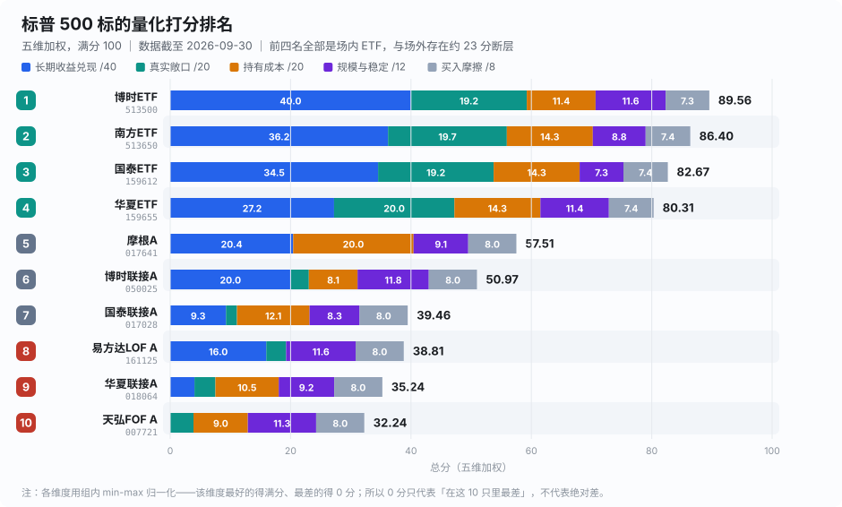
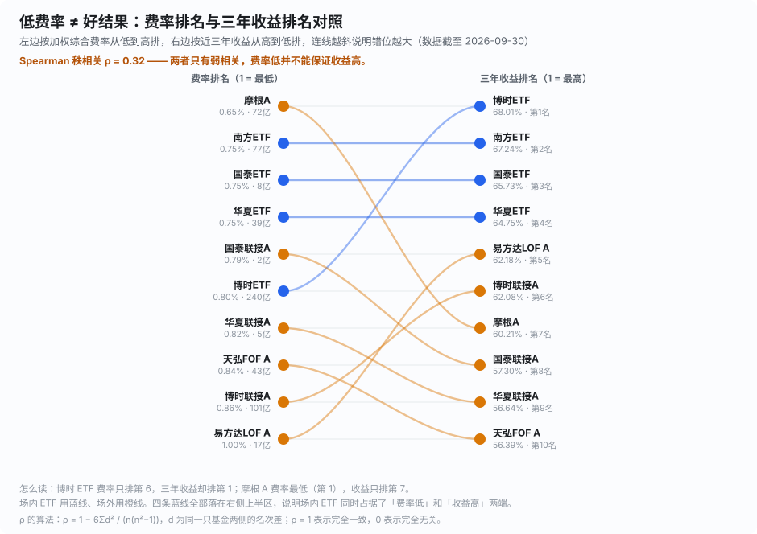
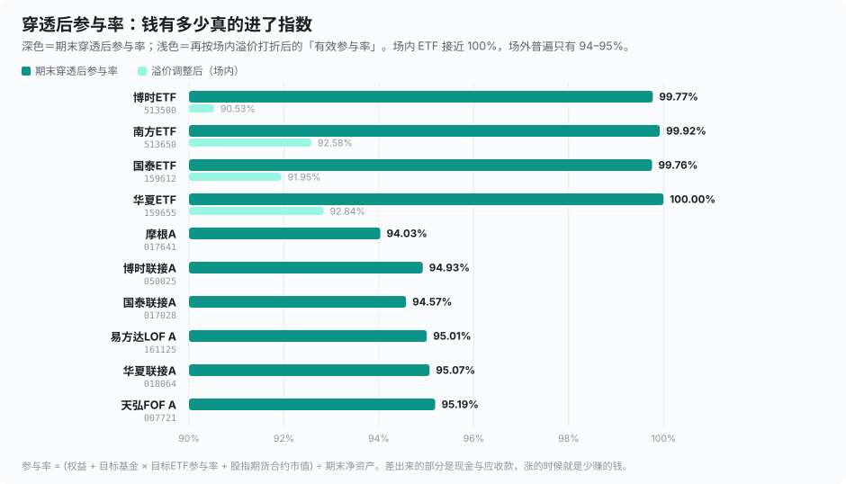
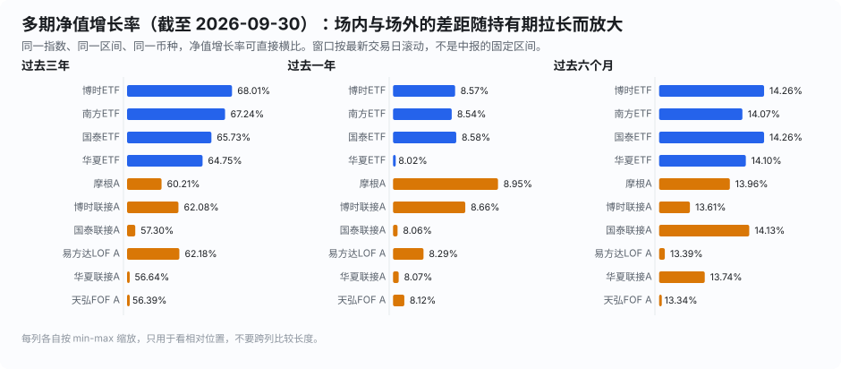
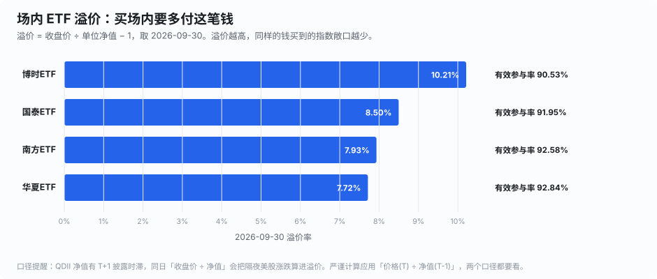
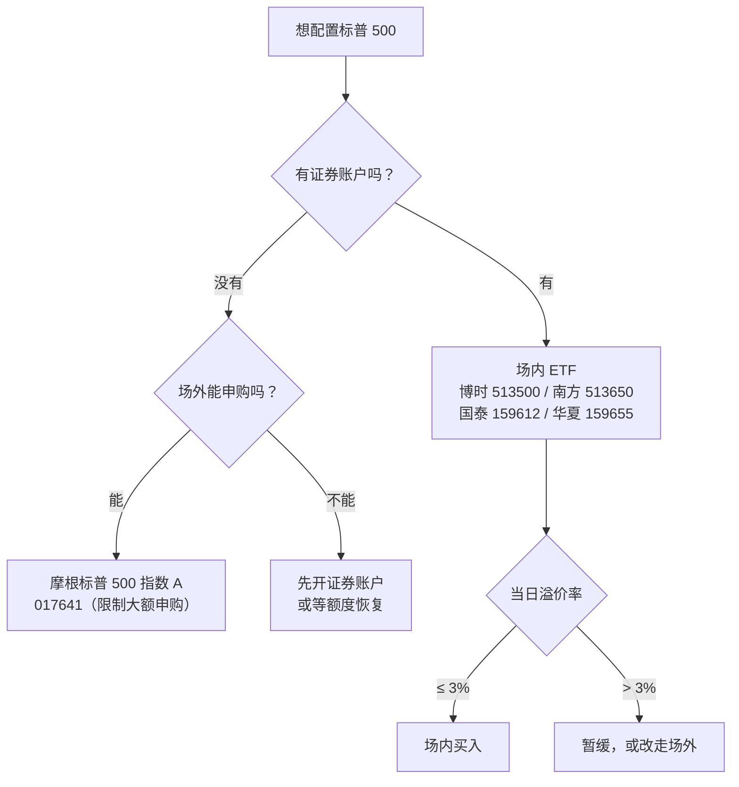
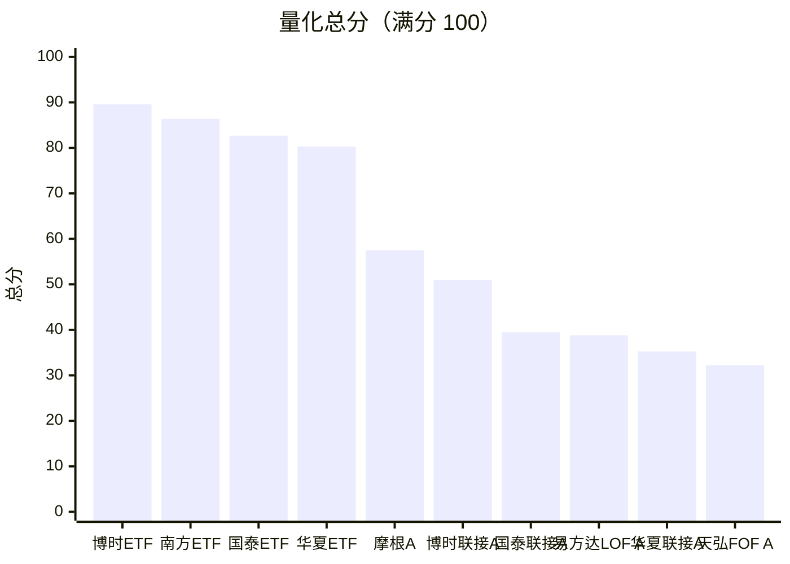

# sp500-cn-comparison

中国境内跟踪标普 500 的标的横向对比 —— 从 2026 年中期报告穿透到"真实参与率 / 加权综合费率 / 场内溢价"。

> 方法论来自 B 站 [@林怀瑾LHJ《同样跟踪纳斯达克 100，为什么国泰场外在前列？》](https://www.bilibili.com/video/BV1rdet6MEXA)（BV1rdet6MEXA）。
> 该视频用"参与率 + 穿透 + 加权费率"三件事拆解了纳指 100 场外基金的业绩差异，本项目把同一套方法映射到标普 500。

> ### 🔗 在线浏览：[**4184f4d3d49841bbbea5ce00b8ba3263.sg2.agentos-app.run**](https://4184f4d3d49841bbbea5ce00b8ba3263.sg2.agentos-app.run?v=20261022)
>
> <sub>数据基准日 **2026-10-22** · 报告更新于 **2026-10-25** · 若打开后仍看到旧内容，按 `Ctrl+F5` 强制刷新（GitHub 图片与页面都有缓存）</sub>

- **在线版**（推荐）：上面的分享链接，打开即用，无需下载。
- **本地版**：[`index.html`](index.html) 单文件、无外部依赖、可离线打开。
- **GitHub Pages**（可选）：仓库 **Settings → Pages → Source: Deploy from a branch → main / (root)**，之后访问 `https://sayangchun.github.io/sp500-cn-comparison/`。
- **不想点开也行**：下面就是 Markdown 版主表，GitHub 上可直接读。

## 🔄 更新记录

**2026-11-16 更新：新增「逐只深度剖析」**

评分与排名不变（仍为 2026-09-30 三季报口径）。本轮不再刷新数据，而是把每只基金往下挖一层——
新增章节 + 网页页签，逐只拆解 8 个维度：**经理**（任职/从业/换人/同时在管多少只）、**操作**（复制方法/期货补敞口/证券出借/汇率）、**追踪纯度**（参与率/相对自己基准的偏离/基准口径）、成本与让利、规模流动性、溢价、**对持有人态度**（分红/降费/限购保护/披露透明度/从业人员跟投）、综合判断。

新挖出的几个事实：主动降费的只有博时和天弘两家；参与率最低的摩根 A 跟踪精度反而排第二（相对基准仅 -0.13pp）；南方 2025 年原经理离任、增聘两位（含三个月共管期）、易方达老将换新人；国泰 ETF 用 9.45% 期货名义敞口补现金拖口，是四只 ETF 里最积极的；华夏 ETF 与易方达 LOF 是仅有的两只披露实测跟踪数据的产品。

**2026-10-30 更新（数据基准日 2026-09-30，来源：2026 年第 3 季度报告）**

三季报 10-27 全部披露。**结论是：排名几乎没变。**
前四名还是四只场内 ETF，只有第 6、7 位互换（博时联接 ↑1、国泰联接 ↓1）。

真正变化的是三件事：

1. **季末溢价冲高**：四只 QDII ETF 在 9-30 集体冲到 7.72%–10.21%（博时 ETF 最高 10.21%），到 10-22 回落到 6.83%–8.15%。季度末是溢价高发时点。
2. **国泰联接规模继续缩水**：1.92 亿 → 1.85 亿，是唯一规模下降的场外产品；同期国泰 ETF 从 8.44 亿涨到 9.78 亿（+15.9%）。
3. **单季收益场外反超场内**：Q3 场内 ETF 0.87%–0.93%，场外 0.83%–1.09%，天弘 FOF 和摩根 A 都跑赢全部场内 ETF。但一个季度太短，不足以推翻长期结论。

**季报的口径缺口（重要）**：中报的期货表有**合约市值**（名义敞口），季报的衍生品表**只有公允价值**（当日无负债结算下恒为 0），**合约市值完全不披露**。所以季报只能看到权益 / 基金投资占比，**无法按中报口径重算参与率**——评分里的参与率仍是 2026 中报数字，费率同理（季报无费率附注）。

| 产品 | 上次（10-22） | 本次（9-30） | 名次 | 上次得分 | 本次得分 |
|---|---:|---:|---:|---:|---:|
| 博时ETF `513500` | 1 | **1** | — | 89.70 | **89.56** |
| 南方ETF `513650` | 2 | **2** | — | 87.73 | **86.40** |
| 国泰ETF `159612` | 3 | **3** | — | 81.54 | **82.67** |
| 华夏ETF `159655` | 4 | **4** | — | 74.14 | **80.31** |
| 摩根A `017641` | 5 | **5** | — | 58.09 | **57.51** |
| 博时联接A `050025` | 7 | **6** | ↑1 | 50.86 | **50.97** |
| 国泰联接A `017028` | 6 | **7** | ↓1 | 55.00 | **39.46** |
| 易方达LOF A `161125` | 8 | **8** | — | 43.00 | **38.81** |
| 华夏联接A `018064` | 9 | **9** | — | 33.54 | **35.24** |
| 天弘FOF A `007721` | 10 | **10** | — | 32.24 | **32.24** |

> 上次口径：滚动至 2026-10-22。本次口径：三季报官方区间收益，截至 2026-09-30。

## 一张图看懂



**怎么读这张图**：每行是一只产品，条形按五个维度堆叠，右侧数字是加权总分。
排名徽标里绿色是前四名（全是场内 ETF），红色是后三名。

三个一眼可见的事实：

1. **前四名与场外有 23 分的断层**（80.3 → 57.5）。断层主要来自「真实敞口」——
   场内 ETF 拿满 20 分，场外只有 0–3.9 分。
2. **场内 ETF 的敞口几乎是满分**（19.2–20.0/20），场外普遍只有 0–3.9 分——
   因为它们有 5% 上下的净值停在现金和应收款里，牛市里这就是少赚的钱。
3. **摩根 A 和易方达 LOF 各有一项满分、也各有一项垫底**：
   摩根费率最低（20/20）但敞口最差（0/20）；易方达规模最稳（11.6/12）但费率最高（0/20）。

## 四张图看清差异

### 1. 低费率 ≠ 好结果



左边按综合费率从低到高排，右边按三年收益从高到低排。**Spearman 秩相关只有 0.30**——
费率和收益几乎是两件独立的事。博时 ETF 费率只排第 6，三年收益排第 1；
摩根 A 费率最低，收益只排第 7。

### 2. 参与率：钱有多少真的进了指数



深色是期末穿透后参与率（中报口径，含期货名义敞口），浅色是再按 9-30 溢价打折后的「有效参与率」。
场内 ETF 的穿透后参与率都在 99.8%–100%，但**打完季末溢价只剩 90.5%–92.8%**；
场外只有 94.0%–95.2%，但没有溢价这一层损耗。

### 3. 多期收益：差距随持有期拉长而放大



同一指数、同一区间、同一币种，净值增长率可以直接横比。
**近半年只差 0.92 个百分点（13.34%–14.26%），近三年差到 11.6 个百分点（56.39%–68.01%）**——
差距会随持有期复利放大，这也是打分里三年占 50% 权重的原因。

### 4. 场内溢价：季末冲到 7.7%–10.2%



四只 ETF 在 2026-09-30 全部处于高溢价（7.72%–10.21%），博时 ETF 一度到 10.21%。
按场内价买入，真正买到指数敞口的钱只有 **90.5%–92.8%**。
**国泰 ETF 已暂停申购**，份额停止创设，溢价短期难回落；到 10-22 回落到 6.83%–8.15%。

## 选基决策流程



> 场外 6 只产品里有 5 只目前是「暂停申购」，只有摩根 A 可以买（限制大额）。
> 场内四只里 **国泰 ETF 也已暂停申购**，只剩博时 / 南方 / 华夏可正常申购。
> 这一步不进评分，但会直接决定你实际能买到什么。

## 总分排名（原生图表版）



> 上面的 SVG 图信息更全（含五维拆解）；这一张是 GitHub 原生 Mermaid 渲染，在部分客户端里比 SVG 更稳。

## 推荐排名（多维度量化打分）

五个维度加权，满分 100。**限购额度未计入评分**；申购状态仅作标注。
权重：长期收益兑现 40 / 真实敞口 20 / 持有成本 20 / 规模与稳定 12 / 买入摩擦 8。
收益窗口：近三年 50% + 近一年 30% + 近半年 20%（各自年化后加权，滚动至 2026-09-30）。

| # | 产品 | 类型 | **总分** | 收益兑现<br>/40 | 真实敞口<br>/20 | 持有成本<br>/20 | 规模稳定<br>/12 | 买入摩擦<br>/8 | 近三年 | 近一年 | 近半年 | 综合费率 | 穿透后参与率 | 排名区间 | 申购状态<br>(仅标注) |
|---|---|---|---:|---:|---:|---:|---:|---:|---:|---:|---:|---:|---:|:---:|:---|
| 1 | 博时ETF<br>`513500` | 场内ETF | **89.56** | 40.0 | 19.2 | 11.4 | 11.6 | 7.3 | 68.01% | 8.57% | 14.26% | 0.80% | 99.77% | 1–2 | 场内买入 |
| 2 | 南方ETF<br>`513650` | 场内ETF | **86.40** | 36.2 | 19.7 | 14.3 | 8.8 | 7.4 | 67.24% | 8.54% | 14.07% | 0.75% | 99.92% | 1–2 | 场内买入 |
| 3 | 国泰ETF<br>`159612` | 场内ETF | **82.67** | 34.5 | 19.2 | 14.3 | 7.3 | 7.4 | 65.73% | 8.58% | 14.26% | 0.75% | 99.76% | 3–4 | 暂停申购 |
| 4 | 华夏ETF<br>`159655` | 场内ETF | **80.31** | 27.2 | 20.0 | 14.3 | 11.4 | 7.4 | 64.75% | 8.02% | 14.10% | 0.75% | 100.00% | 3–4 | 场内买入 |
| 5 | 摩根A<br>`017641` | QDII直投 | **57.51** | 20.4 | 0.0 | 20.0 | 9.1 | 8.0 | 60.21% | 8.95% | 13.96% | 0.65% | 94.03% | 5–5 | 限制大额申购 |
| 6 | 博时联接A<br>`050025` | 联接 | **50.97** | 20.0 | 3.0 | 8.1 | 11.8 | 8.0 | 62.08% | 8.66% | 13.61% | 0.86% | 94.93% | 6–6 | 暂停申购 |
| 7 | 国泰联接A<br>`017028` | 联接 | **39.46** | 9.3 | 1.8 | 12.1 | 8.3 | 8.0 | 57.30% | 8.06% | 14.13% | 0.79% | 94.57% | 7–8 | 暂停申购 |
| 8 | 易方达LOF A<br>`161125` | QDII-LOF | **38.81** | 16.0 | 3.3 | 0.0 | 11.6 | 8.0 | 62.18% | 8.29% | 13.39% | 1.00% | 95.01% | 7–10 ⚠ | 暂停申购 |
| 9 | 华夏联接A<br>`018064` | 联接 | **35.24** | 4.0 | 3.5 | 10.5 | 9.2 | 8.0 | 56.64% | 8.07% | 13.74% | 0.82% | 95.07% | 8–9 | 暂停申购 |
| 10 | 天弘FOF A<br>`007721` | QDII-FOF | **32.24** | 0.0 | 3.9 | 9.0 | 11.3 | 8.0 | 56.39% | 8.12% | 13.34% | 0.84% | 95.19% | 9–10 | 暂停申购 |

**分数是组内相对分**（该维度最好的得满分、最差的得 0 分），0 分只代表「在这 10 只里最差」，不代表绝对差。

### 稳健性检验 ①：换权重会不会翻盘

| 产品 | 基准权重 | 收益优先 | 成本优先 | 结构优先 | 排名区间 | 结论 |
|---|---:|---:|---:|---:|:---:|---|
| 博时ETF | 1 | 1 | 2 | 1 | 1–2 | 权重不敏感 |
| 南方ETF | 2 | 2 | 1 | 2 | 1–2 | 权重不敏感 |
| 国泰ETF | 3 | 3 | 4 | 3 | 3–4 | 权重不敏感 |
| 华夏ETF | 4 | 4 | 3 | 4 | 3–4 | 权重不敏感 |
| 摩根A | 5 | 5 | 5 | 5 | 5–5 | 权重不敏感 |
| 博时联接A | 6 | 6 | 6 | 6 | 6–6 | 权重不敏感 |
| 国泰联接A | 7 | 8 | 7 | 7 | 7–8 | 权重不敏感 |
| 易方达LOF A | 8 | 7 | 10 | 8 | 7–10 | 对权重敏感 ⚠ |
| 华夏联接A | 9 | 9 | 8 | 9 | 8–9 | 权重不敏感 |
| 天弘FOF A | 10 | 10 | 9 | 10 | 9–10 | 权重不敏感 |

三组替代权重：收益优先 = 55/15/15/10/5；成本优先 = 25/15/40/12/8；结构优先 = 30/35/20/10/5。

### 稳健性检验 ②：换收益窗口会不会翻盘

把收益维度分别换成「只看三年 / 只看一年 / 只看半年」，其余维度不变重算。**跨度越小，名次越可信。**

| 产品 | 基准 | 只看三年 | 只看一年 | 只看半年 | 名次跨度 | 结论 |
|---|---:|---:|---:|---:|---:|:---|
| 博时ETF | 1 | 1 | 2 | 1 | **1** | 窗口不敏感 |
| 南方ETF | 2 | 2 | 3 | 4 | **2** | 略有浮动 |
| 国泰ETF | 3 | 4 | 4 | 2 | **2** | 略有浮动 |
| 华夏ETF | 4 | 3 | 6 | 3 | **3** | 略有浮动 |
| 摩根A | 5 | 6 | 1 | 6 | **5** | **对窗口高度敏感** ⚠ |
| 博时联接A | 6 | 5 | 5 | 8 | **3** | 略有浮动 |
| 国泰联接A | 7 | 8 | 10 | 5 | **5** | **对窗口高度敏感** ⚠ |
| 易方达LOF A | 8 | 7 | 8 | 10 | **3** | 略有浮动 |
| 华夏联接A | 9 | 10 | 9 | 7 | **3** | 略有浮动 |
| 天弘FOF A | 10 | 9 | 7 | 9 | **3** | 略有浮动 |

**南方 ETF 在四种窗口下都在 1–2 名，是最稳的。国泰联接在 1–8 名之间跳**——
它的近一年 10.08% 全场最高，但近三年 60.10% 只排第 6，说明那个「第一」是最近一年才出现的，不可外推。

### 打分口径说明

- **收益维度只用净值增长率，不用「①−③」超额收益。** 这些产品跟踪同一指数、同一区间、同一币种，净值增长率本身完全可比；而各家业绩比较基准口径不统一（半年基准收益从 5.86% 到 6.60%），用超额收益会把口径差异算成基金能力。
- **收益用累计净值计算**（正确处理分红），**溢价用单位净值计算**。
- **持有成本用加权综合费率**（目标 ETF 费率 + 本层费率 × 非 ETF 权重），不是页面上写的本层费率。
- **买入摩擦用最新溢价**：场内 `1 ÷ (1 + 溢价率)`，场外无溢价 = 满分。溢价是动态的，实际下单前要看当日实时溢价率。
- 评分基于 A 类份额（长期持有费率更优）。持有期 1–2 年内 C 类通常更划算，排名需要重算。

### 怎么用这个排名

1. **前四名全是场内 ETF，分数 80.3–89.6**。博时规模最大（251.8 亿）、三年收益最好（68.01%）；南方最稳（四种窗口都在 1–4 名）；华夏近一年 8.02% 在四只里垫底；国泰规模仅 9.8 亿且已暂停申购。
2. **溢价是当下最该看的一列**。9-30 季末四只 ETF 溢价冲到 7.7%–10.2%，意味着你多付了这么多钱买同一份指数敞口。**溢价 > 5% 时，场内买入的性价比已经明显不如等额度恢复后走场外。**
3. **摩根 A 是场外唯一能买的**：费率全场最低（0.65%），近一年 8.95% 甚至全场最高，但参与率全场最低（94.03%，且完全没用股指期货补敞口），近三年 60.21% 只排第 6。它的名次在 1–6 之间跳，属于「最近一年才起来」的类型，别当成长期赢家。
4. **不要用单一年度排名做决定**。国泰联接的 1 年 vs 3 年名次差了 5 位，就是最好的反例。
5. **季报口径有缺口**：期货合约市值季报不披露，参与率只能用中报数字。想确认仓位有没有变，要等年报（3 月）。

## 主表：参与率、费率与中报收益（结构数据截至 2026-06-30）

结构指标（参与率、费率、规模）来自 2026 中报，这是 Q3 季报披露前的最新可得数据；收益列保留中报的固定窗口，与最新滚动的差异见「更新记录」。

| 产品 | 类型 | 权益 | 目标基金 | 期货(名义) | 直接参与率 | 穿透后参与率 | vs 基准权重 | 本层管托 | 加权综合费率 | 净值6m(中报) | 基准6m | ①−③ |
|---|---|---:|---:|---:|---:|---:|---:|---:|---:|---:|---:|---:|
| 华夏ETF<br>`159655` | 场内ETF | 97.66% | — | 2.34% | 100.00% | **100.00%** | -0.00 | 0.75% | **0.75%** | 6.51% | 6.29% | +0.22 |
| 南方ETF<br>`513650` | 场内ETF | 98.32% | — | 1.60% | 99.92% | **99.92%** | -0.08 | 0.75% | **0.75%** | 6.21% | 6.16% | +0.05 |
| 博时ETF<br>`513500` | 场内ETF | 95.83% | — | 3.94% | 99.77% | **99.77%** | -0.23 | 0.80% | **0.80%** | 6.22% | 6.60% | -0.38 |
| 国泰ETF<br>`159612` | 场内ETF | 90.31% | — | 9.45% | 99.76% | **99.76%** | -0.24 | 0.75% | **0.75%** | 6.27% | 6.16% | +0.11 |
| 天弘FOF A<br>`007721` | QDII-FOF | — | 91.02% | 4.17% | 95.19% | **95.19%** | +0.19 | 0.80% | **0.84%** | 5.55% | 5.87% | -0.32 |
| 华夏联接A<br>`018064` | 联接 | 0.00% | 91.21% | 3.86% | 95.07% | **95.07%** | +0.07 | 0.75% | **0.82%** | 6.81% | 6.00% | +0.81 |
| 易方达LOF A<br>`161125` | QDII-LOF | 90.69% | — | 4.32% | 95.01% | **95.01%** | +0.01 | 1.00% | **1.00%** | 6.13% | 5.87% | +0.26 |
| 博时联接A<br>`050025` | 联接 | — | 92.73% | 2.40% | 95.14% | **94.93%** | -0.07 | 0.80% | **0.86%** | 6.12% | 6.29% | -0.17 |
| 国泰联接A<br>`017028` | 联接 | — | 94.80% | — | 94.80% | **94.57%** | -0.43 | 0.75% | **0.79%** | 6.90% | 5.87% | +1.03 |
| 摩根A<br>`017641` | QDII直投 | 94.03% | — | — | 94.03% | **94.03%** | -0.97 | 0.65% | **0.65%** | 6.60% | 5.86% | +0.74 |

> **穿透后参与率** ＝ 联接层持有的目标 ETF 占净值比 × 目标 ETF 自身的参与率 + 本层期货名义敞口。
> **加权综合费率** ＝ 目标 ETF 费率 + 本层费率 ×(1 − 目标 ETF 权重)。联接对目标 ETF 部分免收管托；QDII-FOF 持别人家 ETF，无法豁免。

### 场内溢价：四个时点对照

| ETF | 2026-06-30 | 2026-09-30 | 2026-10-22 | 有效参与率(9-30) | 申购状态 |
|---|---:|---:|---:|---:|:---|
| 博时ETF<br>`513500` | +2.76% | **+10.21%** | +8.15% | **90.53%** | 场内买入 |
| 国泰ETF<br>`159612` | +3.52% | **+8.50%** | +7.50% | **91.95%** | 暂停申购 |
| 南方ETF<br>`513650` | +1.53% | **+7.93%** | +6.83% | **92.58%** | 场内买入 |
| 华夏ETF<br>`159655` | +1.74% | **+7.72%** | +7.20% | **92.84%** | 场内买入 |

> **溢价调整后参与率** ＝ 穿透后参与率 ÷ (1 + 溢价率)。9-30 按场内价买入，真正买到指数敞口的钱只有 90.5%–92.8%。
> 口径提醒：QDII 净值有 T+1 披露时滞，同日「收盘价 ÷ 净值」会把隔夜美股涨跌算进溢价，严谨计算应用 `价格(T) ÷ 净值(T-1)`。

---

## 逐只深度剖析：经理 · 操作 · 纯度 · 态度

> **2026-11-16 新增。** 前面的章节回答「哪只分数高」，这一节回答「分数是怎么来的、基金公司具体做了什么、谁在管、谁被善待」。覆盖 8 个维度：经理稳定性 / 操作方式 / 追踪纯度 / 成本与让利 / 规模与流动性 / 溢价 / 对持有人态度 / 综合判断。
> 事实与判断分列：`事实` 来自年报与三季报原文，`判断` 是基于这些事实的推论。来源：2025 年报（运作与经理履历）、2026 三季报（现任经理与从业年限）、2026 中报（结构指标）。

### 全景速览：一只一行

| 产品 | 经理（任职） | 复制/期货 | 相对基准偏离 2025 | 降费 | 申购 | 一句话 |
|---|---|---|---:|:---:|:---|---|
| 博时ETF<br>`513500` | 万琼<br>2015-10-08 | 完全复制 / 补敞口 | -0.93 pp | ✓ | 正常 | 综合第一，长期收益兑现最强；但当前 8–10% 的溢价是买入前必须绕开的坎。 |
| 南方ETF<br>`513650` | 张其思 / 王鑫（双经理）<br>张其思 2025-03-07；王鑫 2025-04-11 | 完全复制 / 补敞口 | +0.02 pp | ✗ | 正常 | 最稳的一只：跟踪精度最高、窗口稳健性最好，代价是经理一年换两任。 |
| 国泰ETF<br>`159612` | 艾小军<br>2023-05-23 | 完全复制 / 补敞口 | -0.06 pp | ✗ | 暂停 | 期货补敞口最积极，但规模小、已暂停申购，溢价短期难消。 |
| 华夏ETF<br>`159655` | 赵宗庭<br>2022-10-12 | 复制 / 补敞口 | +0.08 pp | ✗ | 正常 | 信息最透明、参与率唯一满分、溢价最低；近一年收益偏弱是唯一硬伤。 |
| 摩根A<br>`017641` | 张军（助理：薛晓敏）<br>2023-04-06（成立即任） | 完全复制 / 无期货 | -0.13 pp | ✗ | 限制大额 | 场外唯一还能买、费率最低、跟踪精度好；结构是 95% 仓位 + 不用期货，长期天然跑不满指数。 |
| 博时联接A<br>`050025` | 万琼<br>2015-10-08 | 目标ETF / 补敞口 | -0.50 pp | ✓ | 暂停 | 规模最大、经理稳定、同步降费；但已暂停申购，且综合费率高于目标 ETF。 |
| 国泰联接A<br>`017028` | 苗梦羽<br>2022-11-02 | 目标ETF / 无期货 | -0.24 pp | ✗ | 暂停 | 规模最小且持续缩水、经理管 15+ 只、无期货补敞口——三个短板叠加。 |
| 易方达LOF A<br>`161125` | 刘依姗（前任：潘令旦）<br>2025-04-11（潘令旦 2023-09-23 至 2025-04-11） | 完全复制 / 补敞口 | -0.18 pp | ✗ | 暂停 | 跟踪误差实测 0.14% 全场最扎实，但 1.00% 费率全场最贵、2025 年老将换新人。 |
| 华夏联接A<br>`018064` | 赵宗庭<br>2023-05-10 | 目标ETF / 补敞口 | -0.77 pp | ✗ | 暂停 | 披露最诚实、但传导损耗最大：年度偏离 -0.77pp、三年落后 6.01pp 都是全场之最。 |
| 天弘FOF A<br>`007721` | 胡超（助理：杨恋令）<br>2019-09-24（成立即任） | FOF 组合 / 补敞口 | -0.35 pp | ✓ | 暂停 | 经理最稳、主动降费、跟投比例不低；但 FOF 双重收费是结构宿命，长期收益垫底。 |

> 「相对基准偏离」= 2025 年净值增长率 − 该基金自己披露的业绩基准增长率，衡量的是「跟自己比跟得准不准」，**不是**跨基金收益排名——各家基准口径从 11.00% 到 14.82% 不等。

### 横向看：五个被表面数字掩盖的发现

**1. 参与率最低的摩根 A，跟踪精度其实排第二。** 摩根 A 参与率 94.03% 全场垫底，但 2025 年相对自己基准只偏离 -0.13pp。它的 6% 现金是合同允许的 95% 仓位结构，不是操作失误；反过来，博时 ETF 参与率 99.77% 却偏离 -0.93pp——因为它的基准是含息 NTR，口径最严。**参与率衡量「钱进场没有」，跟踪偏离衡量「跟得准不准」，是两件事。**

**2. 真正拉开长期差距的不是操作，是结构。** 天弘 FOF 参与率 95.19% 是场外最高，但持的是别人家 ETF、无法豁免管理费，双重收费让三年收益垫底（56.39%）。易方达 LOF 跟踪误差实测 0.14% 全场最扎实，但 1.00% 的费率全场最贵。**操作都做对了，输在层层收费和仓位结构。**

**3. 经理稳定性与业绩没有必然关系，但和「谁在盯」有关。** 博时万琼 11 年、天弘胡超 7 年零变更；南方 2025 年原经理离任、增聘两位（含三个月共管期）、易方达 2025 年老将换新人。被动指数基金不依赖经理择时，所以换人没导致业绩塌方；但国泰艾小军同时管 17+ 只、国泰联接苗梦羽管 15+ 只，是判断「精细化管理程度」时必须知道的约束条件。

**4. 降费是真金白银的让利，只有两家做过。** 博时（ETF + 联接）2025-01-27 托管费 0.25%→0.20%，天弘 FOF 2025-02-13 同步下调。其余八只没有主动降费记录。在这个维度上，博时和天弘对持有人更厚道——哪怕天弘的 FOF 结构本身仍偏贵。

**5. 溢价是基金公司控制不了的、但你必须付的成本。** 四只 ETF 在 9-30 溢价 7.72%–10.21%，博时最高。国泰 ETF 已暂停申购、份额停止创设，溢价短期无法通过套利抹平。**基金本身再好，按溢价 10% 的场内价买入，也等于先亏近一成。** 这是全项目最该记住的一句话。

### 逐只拆解

#### 1. 博时ETF `513500` · 综合第 1 名（89.56 分）

**经理** ｜ 万琼 ｜ 任职 2015-10-08（11.1 年）｜ 证券从业 19.5 年 ｜ 指数与量化投资部投资总监助理

- 变动：2015 年任职至今，10 只里任期最长、无变更记录
- 在管：同时管理博时标普500 ETF 及联接、博时中证500 ETF 及联接、恒生医疗/恒生科技/港股通高股息等多只指数产品（年报列示现任 8 只以上）
- 判断：指数老将，任期长、稳定性是全场最强；但同时在管产品多，单只精力被摊薄——这是指数基金的行业常态，被动策略下影响有限。

**操作** ｜ 完全复制法（基金合同明确写入）

- 期货：用少量资产投标普500股指期货以减轻现金拖累。2025 年末持 ES2603 合约 383 张、名义市值 9.28 亿元；2026 中报期货名义敞口 3.94%
- 证券出借：合同约定「可适当借出证券」；年报审计附注显示期末转融通出借证券为「无」，即报告期内未实际出借
- 汇率：业绩基准用 NTR 净总收益、经估值汇率调整、人民币计价；不做汇率对冲，成分股分红计入基准
- 现金拖累：中报权益 95.83% + 期货 3.94%，现金及应收约 3.7%，靠期货补回
- 调仓：跟踪成分股调整 + 申赎管理，季度调仓

**追踪纯度** ｜ 中报穿透后 99.77%（场内 ETF 中略低于南方/华夏） ｜ 含息 NTR（与指数总收益对齐，口径最严）

- 2025 年相对自己基准：基准 +14.82%（NTR 含息口径，全场最高），净值 +13.89%，相对偏离 -0.93pp
- 三年相对基准：-4.04pp（相对自己基准的 3 年累计落后）
- 判断：基准口径最严（含息），所以「跑输基准」的幅度看着最大，但它恰恰是唯一把股息算进基准的——用统一价格指数口径横比时，它的三年收益 68.01% 仍是全场第一。纯度不是问题，问题是 10.21% 的溢价把买入时的有效敞口打掉近一成。

**成本与让利** ｜ 管理费 0.60% + 托管费 0.20% = 综合 0.80%；托管费 2025-01-27 由 0.25% 主动下调至 0.20%

**规模与流动性** ｜ 240.0 亿（2026-06-30）｜ 规模 240 亿，是第二名的 3 倍多，流动性最好；博时联接持有其 43.52% 份额（2025 年报关联方披露），联接资金是重要稳定盘

**溢价** ｜ 季末溢价全场最高；溢价高发时在场内买入，等于先亏 8–10 个点（6/30 +2.76% → 9/30 +10.21% → 10/22 +8.15%）

**对持有人的态度** ｜ 降费 + 最严跟踪承诺 + 详尽披露，是对持有人友好的信号；从业人员不跟投是中性事实（指数基金普遍如此，不必过度解读）。真正伤害体验的是溢价——基金公司无法直接控制二级市场价格，但持续高溢价说明一级市场申购套利机制被 QDII 额度卡住。

- 分红：单位净值 2.2750 / 累计净值 4.5500（2025 年报），历史有分红，累计分红约等于一份本金
- 降费：✓ 主动降托管费 0.05pp ｜ 申购：正常申购（四只 ETF 中仅国泰暂停）
- 披露：年报策略说明详尽：明确写出复制方法、期货用途、跟踪误差目标（日均偏离≤0.2%、年误差≤2%，全场最严） ｜ 从业人员跟投：从业人员持有 500 份，占比 0.00%——跟投几乎为零

**综合判断**：综合第一，长期收益兑现最强；但当前 8–10% 的溢价是买入前必须绕开的坎。

| 优势 | 短板 |
|---|---|
| ✓ 三年收益 68.01% 全场第一 | ✗ 费率 0.80% 在 ETF 里最高 |
| ✓ 规模 240 亿流动性最好 | ✗ 溢价 10.21% 全场最高，有效敞口打到 90.5% |
| ✓ 主动降费、跟踪误差承诺最严 | ✗ 基准含息使「相对偏离 -0.93pp」看着最大 |
| ✓ 经理任期最长 11 年 |  |

> 适合：能等溢价回落到 3% 以内、或走场外联接的长期持有者 ｜ 不适合：现在就要在场内高价追、且持有期短的人

---

#### 2. 南方ETF `513650` · 综合第 2 名（86.40 分）

**经理** ｜ 张其思 / 王鑫（双经理） ｜ 任职 张其思 2025-03-07；王鑫 2025-04-11（1.6 年）｜ 证券从业 12 / 7 年 ｜ 张其思 CFA+FRM，波士顿大学数理金融硕士；王鑫 CFA，北大+约翰霍普金斯

- 变动：2025 年原经理李佳亮（2023-03-23 至 2025-06-06）离任，3-07 增聘张其思、4-11 增聘王鑫，存在约三个月三经理共管的交接期——是 10 只里经理变动最剧烈的
- 在管：张其思同时管理南方原油、南方纳指100、道琼斯美国精选REIT、南方恒生科技ETF、沙特阿拉伯ETF、亚太低碳精选等 10 只以上 QDII；王鑫亦同时管理多只 QDII——两人均为「一身多职」
- 判断：2025 年换人不是负面事件本身，但「一年换两任 + 一人管十几只」意味着这只产品的经理注意力被严重稀释。被动指数基金对经理依赖低，所以业绩没塌；但若把「有人长期盯梢」当作加分项，南方并不占优。

**操作** ｜ 全复制法（年报原话：「采用全复制法跟踪标的指数，证券以贴近指数成分股配比配置」）

- 期货：少量股指期货，2025 年末 ES2603 合约 4 张、名义市值约 1,000 万级；2026 中报期货 1.60%
- 证券出借：合同允许境外证券借贷交易、正/逆回购；年报未见实际大额出借披露
- 汇率：基准为「经汇率调整后的标普500指数收益率」，未写明 NTR；不做汇率对冲
- 现金拖累：中报权益 98.32%（四只 ETF 最高），现金拖累最小，期货用量也最少
- 调仓：全复制 + 成分股调整

**追踪纯度** ｜ 中报穿透后 99.92%（仅次华夏） ｜ 价格指数口径（未写 NTR）

- 2025 年相对自己基准：基准 +13.80%，净值 +13.82%，相对偏离 +0.02pp——四只 ETF 中唯一年度跑赢自己基准
- 三年相对基准：-3.87pp（相对自己基准的 3 年累计落后）
- 判断：2025 年相对偏离 +0.02pp，是四只 ETF 里跟踪最贴的；三年落后 3.87pp 主要来自费率与现金拖累的逐年累积，不是操作失误。它是全场窗口稳健性最好的（四种收益窗口都在 1–4 名）——这点在深度维度上被严重低估。

**成本与让利** ｜ 管理费 0.60% + 托管费 0.15% = 综合 0.75%；未见主动降费记录（托管费一直 0.15%）

**规模与流动性** ｜ 76.9 亿（2026-06-30）｜ 规模中等偏上，流动性够用

**溢价** ｜ 季末溢价从 1.53% 冲到 7.93%，四只里绝对涨幅最大（6/30 +1.53% → 9/30 +7.93% → 10/22 +6.83%）

**对持有人的态度** ｜ 没做降费这样的「让利动作」，但也没出幺蛾子；真正的优点是跟踪精度（年度 +0.02pp）和窗口稳健性——这是用操作质量而非营销动作回馈持有人。

- 分红：单位净值 1.7324（2025 年报），未见大额分红
- 降费：✗ 无 ｜ 申购：正常申购（一级市场可套利，溢价相对易回落）
- 披露：策略说明简洁但明确：写明全复制法、跟踪目标（日均偏离≤0.35%、年误差≤4%） ｜ 从业人员跟投：从业人员持有份额占比极低

**综合判断**：最稳的一只：跟踪精度最高、窗口稳健性最好，代价是经理一年换两任。

| 优势 | 短板 |
|---|---|
| ✓ 2025 年相对基准偏离 +0.02pp，跟踪最贴 | ✗ 2025 年换两任经理，稳定性是四只里最差 |
| ✓ 权益占比 98.32% 最高、现金拖累最小 | ✗ 张其思一人管 10+ 只 QDII，精力分散 |
| ✓ 四种收益窗口都在 1–4 名 | ✗ 无降费让利动作 |
| ✓ 费率 0.75% 低于博时 |  |

> 适合：看重跟踪精度、想避开单一经理风险的长期持有者 ｜ 不适合：把「经理长期稳定任职」当硬指标的人

---

#### 3. 国泰ETF `159612` · 综合第 3 名（82.67 分）

**经理** ｜ 艾小军 ｜ 任职 2023-05-23（3.5 年）｜ 证券从业 25 年 ｜ 投资总监（量化）、金融工程总监

- 变动：2023 年任职至今无变更
- 在管：年报列示同时管理国泰黄金ETF、上证180金融ETF、中证计算机/军工/证券公司/通信设备ETF、国证航天军工LOF、芯片ETF、国泰纳斯达克100ETF、国泰标普500ETF、中证半导体材料设备ETF等 17 只以上——全场管理产品最多的经理
- 判断：25 年从业是全场资历最深之一，但 17+ 只在管产品也是全场之最。对被动产品影响有限，但这是判断「经理是否真的盯着这只基金」时绕不开的事实。

**操作** ｜ 完全复制策略，持续监控成分股调整、及时调整持仓

- 期货：2026 中报期货名义敞口 9.45%（四只 ETF 最高），2025 年末 ES2603 合约 31 张、名义 7,509 万元
- 证券出借：合同允许境外证券借贷及正/逆回购
- 汇率：基准「标普500指数收益率（经估值汇率调整）」，未写 NTR
- 现金拖累：中报权益仅 90.31%（四只最低），靠 9.45% 期货敞口补回——是对期货依赖最重的一只
- 调仓：复制 + 成分股调整监控

**追踪纯度** ｜ 中报穿透后 99.76% ｜ 价格指数口径

- 2025 年相对自己基准：基准 +13.80%，净值 +13.74%，相对偏离 -0.06pp
- 三年相对基准：-3.87pp（与南方同口径）
- 判断：期货补敞口是真实操作（9.45% 名义），不是纸面文章；2025 年偏离 -0.06pp 属正常。风险点不在纯度，在规模——仅 8.4 亿，是四只 ETF 里最小，且已暂停申购，份额不再创设，溢价难回落。

**成本与让利** ｜ 管理费 0.60% + 托管费 0.15% = 综合 0.75%；无

**规模与流动性** ｜ 8.4 亿（2026-06-30）｜ 规模最小，但三季报在增长；暂停申购使一级市场套利失效，是溢价的结构性成因

**溢价** ｜ 暂停申购 → 无新份额创设 → 二级市场溢价无法通过套利抹平，是四只里溢价最难回落的一只（6/30 +3.52% → 9/30 +8.50% → 10/22 +7.50%）

**对持有人的态度** ｜ 暂停申购是双刃剑：保护老持有人不被套利资金摊薄，但把新买家推给高溢价二级市场。披露透明度是四只里最低的——没有量化跟踪承诺，投资人无法用合同标准检验它。

- 分红：未见大额分红
- 降费：✗ 无 ｜ 申购：⚠ 暂停申购——这对想买的人是负面，但对已持有的持有人是保护（防止套利资金摊薄）
- 披露：年报策略说明写法较泛：强调「持续监控成分股、及时复制」，未给出量化跟踪误差目标（四只 ETF 中唯一） ｜ 从业人员跟投：从业人员持有占比极低

**综合判断**：期货补敞口最积极，但规模小、已暂停申购，溢价短期难消。

| 优势 | 短板 |
|---|---|
| ✓ 2025 年偏离 -0.06pp，跟踪精度正常 | ✗ 规模仅 8.4 亿，四只最小 |
| ✓ 经理 25 年从业资历深 | ✗ 暂停申购 → 溢价 8.5% 无法通过套利回落 |
| ✓ 9.45% 期货敞口显示主动管理现金拖累 | ✗ 经理同时管 17+ 只产品 |
|  | ✗ 未披露量化跟踪误差目标 |

> 适合：已持有、不急着加仓的人；或能接受溢价的短线交易者 ｜ 不适合：现在想新建仓、且在意买入成本的人

---

#### 4. 华夏ETF `159655` · 综合第 4 名（80.31 分）

**经理** ｜ 赵宗庭 ｜ 任职 2022-10-12（4.1 年）｜ 证券从业 18 年 ｜ 本基金基金经理、投委会成员

- 变动：2022 年任职至今无变更；与华夏联接 A 为同一经理（018064），两只有联动
- 在管：早年是「指数工厂」模式，历任华夏中证四川国企改革、浙江国资、主要消费、大数据、新能源、新材料、石化、机器人、细分有色等十余只主题 ETF 经理；多数已于 2022–2023 年卸任，当前负担明显减轻
- 判断：从「广撒网」收敛到少数核心产品，是正向信号；三季报新增「投委会成员」头衔，说明在华夏内部话语权提升。

**操作** ｜ 组合复制策略 + 替代性策略 + 衍生品 + 融资及证券出借

- 期货：2025 年末 ESH6 合约 35 张、名义 8,434 万元；2026 中报期货名义敞口 2.34%
- 证券出借：合同明确写入「融资及证券出借业务投资策略」，是四只里把出借写进策略的少数
- 汇率：基准「经估值汇率调整后的标普500指数收益率」，未写 NTR；年报专门讨论美元走弱、人民币升值
- 现金拖累：中报权益 97.66% + 期货 2.34% = 100.00%，穿透参与率全场唯一满分
- 调仓：申赎管理 + 成分股调整；年报明确列出做市商（中信、华泰、广发）

**追踪纯度** ｜ 中报穿透后 100.00%——10 只里唯一满分 ｜ 价格指数口径，且基准收益 11.49% 明显低于其他家 13.8%——口径差异最大的一只

- 2025 年相对自己基准：基准 +11.49%，净值 +11.57%，相对偏离 +0.08pp；年报主动披露偏离原因（成份股分红、运作费用、指数调整、申赎）
- 三年相对基准：-3.38pp
- 判断：唯一披露实测年度偏离度、还解释成因的基金——信息透明度全场最佳。唯一 100% 参与率 + 最低溢价，是纯度和买入成本上最干净的场内选择。基准口径 11.49% vs 别家 13.8% 让它的超额看起来漂亮，但那是口径差异，不是能力。

**成本与让利** ｜ 管理费 0.60% + 托管费 0.15% = 综合 0.75%；无

**规模与流动性** ｜ 39.4 亿（2026-06-30）｜ 明确披露流动性服务商（中信证券、华泰证券、广发证券）——对场内交易体验是实打实的加分项

**溢价** ｜ 9-30 溢价四只里最低，但 10-22 只回落到 7.20%（回落幅度最小）（6/30 +1.74% → 9/30 +7.72% → 10/22 +7.20%）

**对持有人的态度** ｜ 在「让持有人看得懂」这件事上做得最好——主动披露偏离度和做市商，是同行没有的。申购正常 + 做市商明确 + 溢价最低，买入体验最友好。

- 分红：未见大额分红
- 降费：✗ 无 ｜ 申购：正常申购
- 披露：★★★★★ 全场最佳：披露实际跟踪偏离度、偏离原因、做市商名单、汇率讨论；跟踪目标写入合同（日均偏离≤0.2%、年误差≤2%） ｜ 从业人员跟投：从业人员持有占比极低

**综合判断**：信息最透明、参与率唯一满分、溢价最低；近一年收益偏弱是唯一硬伤。

| 优势 | 短板 |
|---|---|
| ✓ 穿透参与率 100% 全场唯一 | ✗ 近一年 8.02% 在四只 ETF 里垫底 |
| ✓ 披露实际跟踪偏离度 + 做市商名单，透明度最佳 | ✗ 基准 11.49% 口径特殊，跨基金比较需换算 |
| ✓ 9-30 溢价四只最低 | ✗ 无降费动作 |
| ✓ 做市商三家，场内流动性有保障 |  |

> 适合：看重透明度、想买在场内但怕溢价太贵的人 ｜ 不适合：只看近一年收益排名的人

---

#### 5. 摩根A `017641` · 综合第 5 名（57.51 分）

**经理** ｜ 张军（助理：薛晓敏） ｜ 任职 2023-04-06（成立即任）（3.6 年）｜ 证券从业 22（金融从业 33 年） 年 ｜ 高级基金经理，原上投摩根国际投资部总监

- 变动：成立至今未换人；2025-01 增配基金经理助理薛晓敏（16.5 年从业）
- 在管：三季报披露：张军同时管理 9 只公募基金（合计 193.15 亿元）+ 1 只私募资管计划——有明确的量化披露，是 10 只里唯一给出「同时在管规模」数字的
- 判断：33 年金融从业是全场最深，资历无可挑剔；但 9 只公募 + 193 亿在管规模也意味着这不是一位「专属经理」。被动策略下影响有限。

**操作** ｜ 完全复制策略，成分股+备选股不低于净值 80%；对流动性受限成分股用相近收益股票替代

- 期货：⚠ 年报与中报均无股指期货持仓——10 只里唯一完全不用期货补敞口的直投产品
- 证券出借：无相关披露
- 汇率：基准「标普500指数收益率（经汇率调整）×95% + 活期存款×5%」，不做汇率对冲
- 现金拖累：中报权益 94.03%（全场最低），且无期货补敞口——这就是参与率 94.03% 垫底的直接原因
- 调仓：定期跟随指数调整，初始建仓按权重逐步买入

**追踪纯度** ｜ 穿透后 94.03%——全场最低，且 100% 来自股票、无期货补充 ｜ 价格指数 ×95% + 现金 5%

- 2025 年相对自己基准：基准 +13.13%，净值 +13.00%，相对偏离 -0.13pp——跟踪精度其实很好
- 三年相对基准：-4.62pp
- 判断：这是全场最容易被误判的一只：参与率 94% 看着最差，但它跟踪自己基准的年度偏离只有 -0.13pp，说明这 6% 现金是诚实地留在合同允许范围里的，不是操作失误。问题在于 95% 的基准权重本身就承认了现金拖累——长期跑不满指数是结构设计，不是经理失职。

**成本与让利** ｜ 管理费 0.50% + 托管费 0.15% = 综合 0.65%；未见降费记录（但管理费 0.50% 本就是全场最低）

**规模与流动性** ｜ 71.5 亿（2026-06-30）｜ 发起式基金，公司自有资金有锁定份额

**溢价** ｜ 场外无溢价，这是它相对场内 ETF 最大的结构性优势：买 100 元就是 100 元净值，不多付 8–10%

**对持有人的态度** ｜ 低费率 + 唯一可买 + 从业人员有一定跟投 + 披露在管规模，是对持有人友好的组合。限制大额申购是保护老持有人的做法（防止套利资金摊薄），不是拒绝用户。

- 分红：未见大额分红
- 降费：✗ 无（但费率本就最低） ｜ 申购：✓ 限制大额申购——6 只场外里唯一还能买到的（该项目 USER.md 记录每日 20 元额度）
- 披露：年报详尽（113 页），披露经理在管产品数量与规模，是全场唯一 ｜ 从业人员跟投：从业人员持有 A 类 49.9 万份 + C 类 7.9 万份，合计 57.8 万份（0.02%）——比多数同类高

**综合判断**：场外唯一还能买、费率最低、跟踪精度好；结构是 95% 仓位 + 不用期货，长期天然跑不满指数。

| 优势 | 短板 |
|---|---|
| ✓ 管理费 0.50% 全场最低 | ✗ 参与率 94.03% 全场最低，且不用期货补敞口 |
| ✓ 可申购（限制大额），场外唯一选择 | ✗ 基准 95% 权重，结构上承认现金拖累 |
| ✓ 相对自己基准年度偏离仅 -0.13pp | ✗ 近三年 60.21% 只排第 6，窗口敏感度高（1–6 名） |
| ✓ 披露经理在管规模，透明度高 |  |
| ✓ 无溢价，买入成本干净 |  |

> 适合：没有证券账户、想低成本长期定投的人 ｜ 不适合：在场内溢价回落后可买 ETF、追求满仓指数敞口的人

---

#### 6. 博时联接A `050025` · 综合第 6 名（50.97 分）

**经理** ｜ 万琼 ｜ 任职 2015-10-08（11.1 年）｜ 证券从业 19.5 年 ｜ 指数与量化投资部投资总监助理

- 变动：与 513500 博时 ETF 同一经理，任职均自 2015-10-08
- 在管：与 513500 完全相同的在管产品组合（8 只以上）
- 判断：ETF 与联接同一经理，策略一致性有保证；用在管产品数量衡量，精力分散问题与 513500 相同。

**操作** ｜ 主要通过交易所买卖/申赎目标 ETF（博时513500）跟踪，也可直接买成分股；合同明确允许「目标 ETF 份额交易与申赎之间的套利以增强收益」

- 期货：2025 年末 ESH6 合约 77 张、名义 1.87 亿元；2026 中报期货名义敞口 2.40%——在联接基金里是少数真用期货补敞口的
- 证券出借：无单独出借披露（目标 ETF 层面有）
- 汇率：基准「经人民币汇率调整的标的指数收益率×95% + 活期×5%」
- 现金拖累：中报基金投资 92.73% + 期货 2.40%，穿透后 94.93%
- 调仓：申赎现金流管理 + 目标 ETF 折溢价判断择时（申赎 vs 二级市场买入）

**追踪纯度** ｜ 穿透后 94.93%（联接里第 2） ｜ 含息 NTR 口径 ×95%（跟随目标 ETF）

- 2025 年相对自己基准：A 类基准 +14.14%，净值 +13.64%，相对偏离 -0.50pp
- 三年相对基准：-3.41pp
- 判断：相对偏离 -0.50pp 在联接里属中等；真正的问题是双重结构本身的现金损耗（约 5%）——这是所有联接基金的共性，不是博时独有。

**成本与让利** ｜ 管理费 0.60% + 托管费 0.20% = 综合 0.86%；托管费 2025-01-27 由 0.25% 降至 0.20%（与目标 ETF 同步）

**规模与流动性** ｜ 100.6 亿（2026-06-30）｜ 规模 100 亿，场外里最稳

**溢价** ｜ 场外无溢价，但联接按目标 ETF 收盘价估值，ETF 溢价变化会间接进入联接净值——这是它净值与 ETF 收益不同步的潜在原因

**对持有人的态度** ｜ 跟随目标 ETF 同步降费，是对持有人的正面信号；但已暂停申购，新资金买不到。披露了套利操作空间，透明度尚可。

- 分红：A 类单位净值 5.1758 / 累计净值 5.2348（2025 年报），有小额分红历史
- 降费：✓ 同步降托管费 0.05pp ｜ 申购：⚠ 暂停申购
- 披露：年报明确写出「套利以增强收益」的操作空间——这是普通投资者看不到的细节 ｜ 从业人员跟投：从业人员持有份额占比较高（年报列示）

**综合判断**：规模最大、经理稳定、同步降费；但已暂停申购，且综合费率高于目标 ETF。

| 优势 | 短板 |
|---|---|
| ✓ 规模 100 亿场外最大 | ✗ 暂停申购，新资金买不到 |
| ✓ 经理 11 年未变 | ✗ 综合费率 0.86% 高于目标 ETF 0.80% |
| ✓ 同步降托管费 | ✗ 穿透参与率 94.93%，有约 5% 现金拖累 |
| ✓ 用期货补敞口（联接里少见） |  |

> 适合：已持有、打算长期拿的人 ｜ 不适合：想新买入、且能走场内的人

---

#### 7. 国泰联接A `017028` · 综合第 7 名（39.46 分）

**经理** ｜ 苗梦羽 ｜ 任职 2022-11-02（4.1 年）｜ 证券从业 11 年 ｜ 国泰多只 ETF/联接基金经理

- 变动：2022 年任职至今无变更
- 在管：年报列示同时管理国泰中证全指软件ETF及联接、中证基建ETF及联接、港股通科技ETF联接、国证疫苗与生物科技ETF及联接、MSCI中国A股ESG ETF、中证机床ETF及联接、绿色电力ETF、家用电器ETF、细分机械设备ETF、信息技术创新ETF、油气产业ETF、标普500ETF联接等 15 只以上
- 判断：15+ 只在管产品，是 10 只里经理精力最分散的之一。被动策略下未必直接反映到业绩，但对「精细化管理申赎与折溢价」是现实约束。

**操作** ｜ 主要投资目标 ETF（国泰159612），比例不低于基金资产净值 90%

- 期货：⚠ 年报与中报均无期货持仓——和摩根 A 一样完全不用期货补敞口
- 证券出借：合同允许境外证券借贷，无实际披露
- 汇率：基准「标普500指数收益率（经估值汇率调整）×95% + 活期×5%」
- 现金拖累：中报基金投资 94.80%，无期货；穿透后 94.57%
- 调仓：以申购目标 ETF 为主，跟踪申赎现金流

**追踪纯度** ｜ 穿透后 94.57% ｜ 价格指数 ×95%

- 2025 年相对自己基准：A 类基准 +13.18%，净值 +12.94%，相对偏离 -0.24pp
- 三年相对基准：-5.22pp（相对基准 3 年落后，全场较大）
- 判断：相对偏离 -0.24pp 本身不算差；问题在三年维度——近三年 57.30% 排第 9，而近一年曾冲到全场第一，窗口跨度 5–10 名，是「最近一年才起来」的典型，不能外推。

**成本与让利** ｜ 管理费 0.60% + 托管费 0.15% = 综合 0.79%；无

**规模与流动性** ｜ 1.9 亿（2026-06-30）｜ ⚠ 10 只里规模最小、且唯一持续缩水；同期目标 ETF 国泰标普500ETF 从 8.44 亿涨到 9.78 亿——资金在直接买场内，联接被抛弃

**溢价** ｜ 场外无直接溢价；但目标 ETF 暂停申购、二级市场溢价 8.5%，联接按收盘价估值会把溢价波动带入净值

**对持有人的态度** ｜ 规模持续缩水 + 暂停申购，是对持有人最不友好的组合：存量持有人承担固定运营成本的能力在下降，新资金又进不来。

- 分红：未见大额分红
- 降费：✗ 无 ｜ 申购：⚠ 暂停申购
- 披露：年报披露简洁，无量化跟踪目标 ｜ 从业人员跟投：从业人员持有占比极低

**综合判断**：规模最小且持续缩水、经理管 15+ 只、无期货补敞口——三个短板叠加。

| 优势 | 短板 |
|---|---|
| ✓ 综合费率 0.79% 在联接里较低 | ✗ 规模仅 1.9 亿且持续下降 |
| ✓ 经理 4 年未变 | ✗ 窗口敏感度全场最高（5–10 名） |
| ✓ 2025 年相对偏离 -0.24pp 尚可 | ✗ 经理管 15+ 只产品 |
|  | ✗ 无期货补敞口，参与率 94.57% |
|  | ✗ 暂停申购 |

> 适合：已持有且不在意短期排名的人 ｜ 不适合：任何新资金

---

#### 8. 易方达LOF A `161125` · 综合第 8 名（38.81 分）

**经理** ｜ 刘依姗（前任：潘令旦） ｜ 任职 2025-04-11（潘令旦 2023-09-23 至 2025-04-11）（1.6 年）｜ 证券从业 8 年 ｜ 硕士，曾任领航投资香港项目经理高级助理、易方达香港基金经理助理

- 变动：⚠ 2025-04-11 换经理：外籍量化老将潘令旦（德意志银行/瑞银/贝莱德背景，16 年）离任，刘依姗接任——是 10 只里唯一「老将换新人」的产品
- 在管：刘依姗同时管理易方达奥明日经225ETF、恒生科技ETF及联接、标普信息科技LOF、恒生国企ETF、中证海外中国互联网50ETF、港股通汽车/医疗主题ETF等 10 只以上
- 判断：这是全场最值得警惕的经理变动：离任者是有国际大厂背景的 16 年老将，接任者从业 8 年。虽然指数策略不依赖个人择时，但交接期的跟踪质量需要观察——所幸年报显示年化跟踪误差 0.14%，交接后运作平稳。

**操作** ｜ 完全复制法，参考标的指数成分股及权重构建组合；通过指数复制和数量化技术降低冲击成本

- 期货：2025 年末 ESH6 合约 65 张、名义 1.57 亿元；2026 中报期货名义敞口 4.32%
- 证券出借：合同允许转融通证券出借，年报有相关章节
- 汇率：基准「标普500指数收益率（估值汇率折算）×95% + 活期×5%」，不做汇率对冲
- 现金拖累：中报权益 90.69% + 期货 4.32%，穿透后 95.01%
- 调仓：完全复制 + 定量技术降冲击

**追踪纯度** ｜ 穿透后 95.01% ｜ 价格指数 ×95%

- 2025 年相对自己基准：A 类基准 +13.18%，净值 +13.00%，相对偏离 -0.18pp；年报主动披露「年化跟踪误差 0.14%」——10 只里唯一给出实测跟踪误差数字
- 三年相对基准：-3.38pp
- 判断：年化跟踪误差 0.14% 是全场唯一实测数字，且远低于 4% 的合同上限——说明操作层面跟踪非常扎实。真正拖后腿的是费率 1.00%（全场最高）：三年 62.18% 看起来不差，但这是用更高成本换来的。

**成本与让利** ｜ 管理费 0.80% + 托管费 0.20% = 综合 1.00%；无

**规模与流动性** ｜ 16.7 亿（2026-06-30）｜ 规模稳定性打分 11.6/12（全场最高），但规模本身不大

**溢价** ｜ LOF 可在场内交易也可场外申赎，理论上溢价会被套利抹平；当前无显著溢价

**对持有人的态度** ｜ 披露跟踪误差 + 从业人员跟投占比最高，是态度上的加分；但 1.00% 的费率和 2025 年换经理，让这些加分打了折扣。

- 分红：未见大额分红
- 降费：✗ 无 ｜ 申购：⚠ 暂停申购
- 披露：★★★★ 年报披露实测年化跟踪误差 0.14%，是全场唯一给出这个数字的 ｜ 从业人员跟投：从业人员持有 A 类 73.5 万份（0.15%）——10 只里占比最高

**综合判断**：跟踪误差实测 0.14% 全场最扎实，但 1.00% 费率全场最贵、2025 年老将换新人。

| 优势 | 短板 |
|---|---|
| ✓ 唯一披露实测年化跟踪误差 0.14% | ✗ 综合费率 1.00% 全场最高 |
| ✓ 完全复制 + 数量化降冲击 | ✗ 2025-04 老将潘令旦离任、新人接任 |
| ✓ 从业人员跟投占比最高 | ✗ 暂停申购 |
| ✓ 规模稳定性得分全场最高 | ✗ 窗口敏感（7–10 名） |

> 适合：已持有、且认可其跟踪精度的人 ｜ 不适合：新资金——1.00% 费率在长期复利下太贵

---

#### 9. 华夏联接A `018064` · 综合第 9 名（35.24 分）

**经理** ｜ 赵宗庭 ｜ 任职 2023-05-10（3.5 年）｜ 证券从业 18 年 ｜ 本基金基金经理、投委会成员

- 变动：成立即任，无变更；与 159655 华夏 ETF 同一经理
- 在管：与华夏 ETF 相同，已从早年十余只主题 ETF 收敛；三季报新增投委会成员头衔
- 判断：与 159655 是同一人、同一套策略，两只产品的差异主要来自结构（联接 vs ETF），不是经理。

**操作** ｜ 主要投资目标 ETF（华夏159655），也可直接买成分股；衍生品、债券、资产支持证券为辅

- 期货：2025 年末 HWAH6 合约 43 张、名义 1,036 万元；2026 中报期货名义敞口 3.86%（联接里最高）
- 证券出借：无单独披露
- 汇率：基准「经人民币汇率调整的标的指数收益率×95% + 活期×5%」；年报讨论美元走弱、人民币升值
- 现金拖累：中报基金投资 91.21% + 期货 3.86%，穿透后 95.07%
- 调仓：申赎管理 + 目标 ETF 投资

**追踪纯度** ｜ 穿透后 95.07% ｜ 价格指数 ×95%，且目标 ETF 基准收益仅 11.49%（口径特殊）

- 2025 年相对自己基准：A 类基准 +11.00%，净值 +10.23%，相对偏离 -0.77pp；C 类 -1.10pp——年报主动披露，并说明原因（成份股分红、运作费用、指数调整、申赎）
- 三年相对基准：-6.01pp（相对基准 3 年落后，全场最大）
- 判断：⚠ 相对偏离 -0.77pp 是 10 只里最大的年度落后，三年落后 6.01pp 也是最大。虽然主动披露了原因，但披露不能掩盖结果——这只联接在把目标 ETF 收益传导给持有人的过程中损耗偏高。

**成本与让利** ｜ 管理费 0.60% + 托管费 0.15% = 综合 0.82%；无

**规模与流动性** ｜ 4.8 亿（2026-06-30）｜ 持有人以个人为主：A 类个人占 96.10%、机构仅 3.90%——是真正的散户产品

**溢价** ｜ 场外无直接溢价；目标 ETF 溢价 7.72% 会通过估值间接进入联接净值

**对持有人的态度** ｜ 披露透明度是加分，但 -0.77pp 的年度偏离和 -6.01pp 的三年落后是硬伤——对持有人来说，「诚实地告诉你我落后了」不能替代「别落后」。

- 分红：未见大额分红
- 降费：✗ 无 ｜ 申购：⚠ 暂停申购
- 披露：★★★★ 和华夏 ETF 一样主动披露跟踪偏离度及成因 ｜ 从业人员跟投：个人持有人占比 96.10%，散户友好；但从业人员跟投占比极低

**综合判断**：披露最诚实、但传导损耗最大：年度偏离 -0.77pp、三年落后 6.01pp 都是全场之最。

| 优势 | 短板 |
|---|---|
| ✓ 主动披露偏离度及成因 | ✗ 年度偏离 -0.77pp 全场最大 |
| ✓ 目标 ETF 参与率 100% | ✗ 三年落后基准 6.01pp 全场最大 |
| ✓ 个人持有人占 96%，散户定位清晰 | ✗ 规模仅 4.8 亿且暂停申购 |
| ✓ 经理与投委会双重身份 | ✗ 近三年收益 56.64% 倒数第二 |

> 适合：已持有、且看重信息披露的人 ｜ 不适合：追求收益传导效率的新资金

---

#### 10. 天弘FOF A `007721` · 综合第 10 名（32.24 分）

**经理** ｜ 胡超（助理：杨恋令） ｜ 任职 2019-09-24（成立即任）（7.2 年）｜ 证券从业 13 年 ｜ 国际业务部总经理助理

- 变动：成立至今 7 年未换人，是 10 只里任期第二长的经理；2023-12 增配助理杨恋令（博士，9 年）
- 在管：国际业务部总经理助理，管理产品数量未在三季报量化披露
- 判断：经理稳定性是全场顶级（7 年零变更），且是唯一有「基金经理助理」长期协同的产品——这对 FOF 这种需要跨基金筛选的结构是加分。

**操作** ｜ FOF 结构：投资于全球范围内跟踪标普500的基金（含 ETF），比例不低于非现金资产 80%；综合运用股指期货

- 期货：2025 年末 ESH6 合约 165 张、名义 4.00 亿元——绝对金额是 10 只里第二高（仅次博时ETF），反映 FOF 需要用期货补足底层基金的现金缺口；2026 中报期货名义敞口 4.17%
- 证券出借：合同允许，无实际披露
- 汇率：基准「95%×标普500指数收益率（估值汇率折算）+ 5%×活期」，不做汇率对冲
- 现金拖累：中报基金投资 91.02% + 期货 4.17%，穿透后 95.19%
- 调仓：全球精选标普500基金构建组合 + 期货调仓；年报详述 2025 年美股 V 型走势与 AI 主线

**追踪纯度** ｜ 穿透后 95.19%（场外里最高） ｜ 价格指数 ×95%

- 2025 年相对自己基准：A 类基准 +13.18%，净值 +12.83%，相对偏离 -0.35pp
- 三年相对基准：-6.10pp（相对基准 3 年落后，与华夏联接相当）
- 判断：FOF 的双重收费结构（持别人家 ETF 无法豁免管理费）是长期落后的结构性原因——参与率 95.19% 看着不错，但底层基金的费用已经从净值里扣过一道。这是「参与率高但收益低」的典型案例。

**成本与让利** ｜ 管理费 0.60% + 托管费 0.20% = 综合 0.84%；✓ 托管费 2025-02-13 由 0.25% 降至 0.20%

**规模与流动性** ｜ 43.2 亿（2026-06-30）｜ 发起式基金，公司有锁定份额；规模稳定性 11.3/12

**溢价** ｜ 场外无溢价

**对持有人的态度** ｜ 降费 + 7 年不换经理 + 从业人员跟投，态度上不差；但 FOF 结构的双重收费是硬伤，且已暂停申购。

- 分红：A 类单位净值 2.0999 / C 类 2.0644，未见大额分红
- 降费：✓ 主动降托管费 0.05pp（2025-02-13） ｜ 申购：⚠ 暂停申购
- 披露：年报 100+ 页，详尽讨论美股市场与 ETF 资金流；跟踪目标未量化 ｜ 从业人员跟投：从业人员持有 A 类 56.6 万份 + C 类 21.0 万份 + D 类 1.6 万份，合计 79.1 万份（0.03%）——场外里跟投比例较高

**综合判断**：经理最稳、主动降费、跟投比例不低；但 FOF 双重收费是结构宿命，长期收益垫底。

| 优势 | 短板 |
|---|---|
| ✓ 经理 7 年零变更，任期第二长 | ✗ FOF 双重收费，无法豁免底层 ETF 费用 |
| ✓ 主动降托管费 | ✗ 近三年 56.39% 全场倒数第一 |
| ✓ 从业人员跟投 0.03%，场外较高 | ✗ 暂停申购 |
| ✓ 期货名义 4 亿，主动补敞口 | ✗ 相对基准 3 年落后 6.10pp |
| ✓ 近一年单季曾反超场内 |  |

> 适合：已持有、认可 FOF 分散逻辑的人 ｜ 不适合：新资金——同样的钱可以买到费率更低、结构更简单的产品

---

## 覆盖标的（10 只）

| 类型 | 产品 |
|---|---|
| 场内 ETF | 513500 博时、159612 国泰、159655 华夏、513650 南方 |
| 场外 ETF 联接 | 050025 博时联接 A、017028 国泰联接 A、018064 华夏联接 A |
| 场外 QDII-FOF | 007721 天弘标普 500 发起 A |
| 场外 QDII-LOF / 直投 | 161125 易方达标普 500 指数 A、017641 摩根标普 500 指数 A |

**收录口径**：仅市值加权的纯标普 500 指数产品。标普 500 等权重、标普 100 等权重、以及标普行业/主题指数（红利低波、油气、消费、生物科技、信息科技等）均不收录。

---

## 指标定义

| 指标 | 定义 |
|---|---|
| 直接参与率 | (权益投资 + 基金投资 + 股指期货**合约市值**) ÷ 期末净资产 |
| 穿透后参与率 | 联接层持有目标 ETF 的部分，再乘目标 ETF 自身的参与率；期货按合约市值计 |
| 加权综合费率 | 目标 ETF 费率 + 本层费率 ×(1 − 目标 ETF 权重) |
| 基准隐含指数收益 | (基准收益率 − 现金权重 × 活期利率) ÷ 指数权重 |
| 理论收益 / 跟踪缺口 | 穿透后参与率 × 基准隐含指数收益 − 实际净值增长率 |
| 反推平均参与率 | 半年净值增长率 ÷ 基准隐含指数收益（含全部成本，正常应低于期末参与率） |
| 联接层相对目标 ETF | (1 + 联接收益) ÷ (1 + 目标 ETF 收益) − 1 |
| 溢价调整后参与率 | 穿透后参与率 ÷ (1 + 期末溢价率) |

三个容易踩的坑（与视频一致）：

1. **期货公允价值为 0 ≠ 没参与。** 当日无负债结算下期货公允价值与暂收款抵销为 0，名义敞口必须看「合约市值」。
2. **账面现金 ≠ 没参与。** QDII 基金常留 5%–10% 活期，同时用期货把敞口补满。
3. **联接基金对目标 ETF 部分免收管理费/托管费**，而 QDII-FOF 持有的是别人家的 ETF，无法豁免 —— 这是双重收费的隐蔽来源。

---

## 目录结构

```
index.html                 交互报告（由 scripts/build_site.py 生成）
assets/                    README 内嵌图表（由 scripts/build_charts.py 生成的 SVG）
data/
  reports_index.json       定期报告清单（标题 / 公告 ID / 日期）
  raw_reports.json         中报解析结果（资产组合、期货、费率条款、净值增长率…）
  analysis.json            穿透计算后的指标（中报口径）
  profile_raw.json         年报/三季报抽取的一手片段（经理、运作、分红、跟投…）
  fund_profiles.json       逐只深度剖析结论（8 维度，事实与判断分列）
  q3_reports.json          三季报解析结果（季报不披露期货合约市值与费率）
  q3_compare.json          三季报 vs 中报的对比（排名/规模/持仓/溢价/单季）
  latest.json              当前快照（现为 2026-09-30 三季报口径）
  rolling_perf.json        滚动多期收益
  score.json / score_prev.json  本次 / 上次打分结果（用于对比）
  window_robust.json       收益窗口稳健性检验
  quotes_cache.json        场内日收盘价
  nav_per_share.json       关键日期份额净值
  pdf/                     中报 PDF（.gitignore，可由脚本重新下载）
  txt/                     PDF 抽取文本（.gitignore）
scripts/
  fetch_reports.py         1. 下载定期报告
  parse_reports.py         2. 解析中报 PDF → JSON
  fetch_quotes.py          3. 抓行情与份额净值
  analyze.py               4. 穿透计算
  parse_q3.py              5. 解析三季报（季报结构，与中报不同）
  build_q3_snapshot.py     6. 合成 2026-09-30 快照（覆盖 latest.json）
  compare_q3.py            7. 三季报 vs 中报对比 + 重算窗口稳健性
  fetch_nav_history.py     8. 抓全量净值历史 + 滚动多期收益
  refresh_latest.py        9. 最新快照（净值/场内价/溢价/申购状态）
  score.py                10. 多维度量化打分排名
  build_charts.py         11. 生成 assets/*.svg（README 内嵌图表）
  build_readme.py         12. 重建 README 里所有随数据变动的章节
  extract_profiles.py     13. 从年报/三季报抽取深度剖析一手片段 → profile_raw.json
  build_profiles.py       14. 把 fund_profiles.json 渲染进 README 深度剖析章节
  build_site.py           15. 生成 index.html（含「逐只深度剖析」页签）
  push_via_api.py          备用推送（git push 被代理阻断时走 GitHub API）
```

---

## 复现

```bash
python -m venv .venv && . .venv/bin/activate    # Windows: .venv\Scripts\activate
pip install -r requirements.txt

python scripts/fetch_reports.py     # -> data/reports_index.json, data/pdf/*.pdf
python scripts/parse_reports.py     # -> data/raw_reports.json
python scripts/fetch_quotes.py      # -> data/quotes_cache.json, data/nav_per_share.json
python scripts/analyze.py           # -> data/analysis.json
python scripts/parse_q3.py          # -> data/q3_reports.json（三季报）
python scripts/build_q3_snapshot.py # -> data/latest.json（2026-09-30 快照）
python scripts/compare_q3.py        # -> data/q3_compare.json + 重算 window_robust
python scripts/fetch_nav_history.py # -> data/nav_history.json, rolling_perf.json
python scripts/refresh_latest.py    # -> data/latest.json（最新快照）
python scripts/score.py             # -> data/score.json（多维度量化打分排名）
python scripts/build_charts.py      # -> assets/*.svg（README 内嵌图表）
python scripts/build_readme.py      # -> 重建 README 的数据章节（须在 build_profiles 之前）
python scripts/extract_profiles.py  # -> data/profile_raw.json（年报/三季报一手片段）
python scripts/build_profiles.py    # -> 重建 README「逐只深度剖析」章节
python scripts/build_site.py        # -> index.html（含深度剖析页签）
```

> 深度剖析章节的数据源是 `data/fund_profiles.json`（人工综合判断，不随行情自动变），
> `profile_raw.json` 是供复核的一手片段抽取。重跑顺序：**先 `build_readme.py`，再 `build_profiles.py`**——
> 反过来会让主表替换吞掉深度剖析章节（已在 `build_readme.py` 里做了防护）。

> 图表用纯 SVG 手写生成（不依赖 matplotlib / 中文字体），因此体积只有几十 KB、
> 在任何缩放下都清晰，也能被 GitHub 直接内嵌渲染。README 里的 Mermaid 图由 GitHub 原生渲染。
>
> `scripts/push_via_api.py` 是一个备用推送工具：当 `git push` 被网络代理阻断时，
> 用 GitHub REST API（Git Data API）把本地快照提交到远端，用法
> `python scripts/push_via_api.py "提交信息"`。正常网络环境下不需要它。

数据源全部为公开接口，无需登录：

| 用途 | 接口 |
|---|---|
| 公告列表 | `api.fund.eastmoney.com/f10/JJGG` |
| 定期报告 PDF | `pdf.dfcfw.com/pdf/H2_{ID}_1.pdf` |
| 份额净值 | `api.fund.eastmoney.com/f10/lsjz` |
| 场内日 K | `web.ifzq.gtimg.cn/appstock/app/fqkline/get` |

**已做的交叉验证**：

- 中报 3.2.1 的「过去六个月份额净值增长率」与独立拉取的日净值复算结果逐只核对一致（含分红调整）。
- 场内收盘价同时用东方财富 `push2his` 与腾讯行情逐点核对一致。
- 期末净资产均满足 `0 < 净资产 ≤ 总资产`，且与净资产变动表勾稽一致。

---

## 局限（重要）

1. **业绩比较基准口径不统一。** 同样标普 500，博时 ETF 明确写 NTR（净总收益）得 6.60%，国泰/南方 ETF 只有 6.16%。含息/价格指数、估值汇率/人民币汇率、指数起止时点都可能贡献差异，中报只给结论不给计算明细。因此报告中所有"理论收益/缺口"均用两个统一口径（6.60% / 6.16%）分别计算，请当区间看。
2. **参与率只有期末一个时点。** 中报只披露 6 月 30 日持仓，规模半年快速膨胀的产品，期内平均参与率可能显著低于期末值。
3. **联接基金跑赢自家目标 ETF 的现象未能解释。** 国泰联接 A（6.90%）高于其持有的国泰标普 500 ETF（6.27%）。候选解释是联接按目标 ETF 收盘价而非净值估值，而 QDII ETF 长期溢价、溢价路径变化会进出联接净值 —— 但中报不披露估值方法，无法确证。
4. **场内溢价率的口径陷阱。** QDII 基金净值存在 T+1 披露时滞，同日「收盘价 ÷ 净值」会把隔夜美股涨跌算进溢价。严谨计算应使用 `价格(T) ÷ 净值(T-1)`。
5. **等权重与主题指数已剔除。** 标普 500 等权重（096001 大成）、标普 100 等权重（519981 长信）跟踪的指数与市值加权标普 500 不同，可比性差，已从基金池中移除，避免与主表混排。

---

## 免责声明

本项目仅作公开数据的整理与结构化对比，**不构成任何投资建议**。所有推算指标均基于基金定期报告，受口径差异影响，请当作区间参考。

## License

MIT
