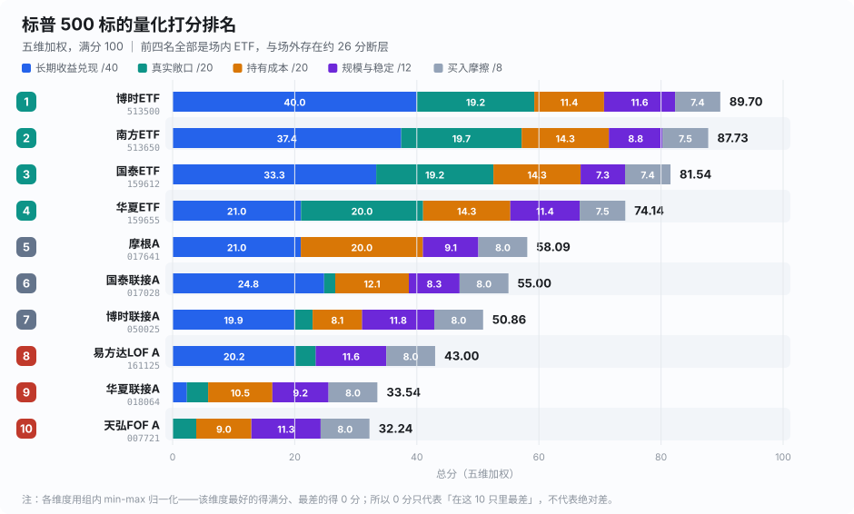
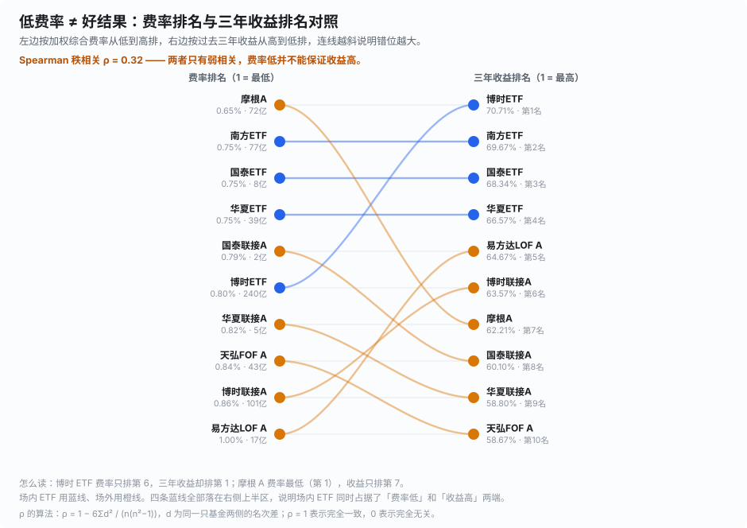
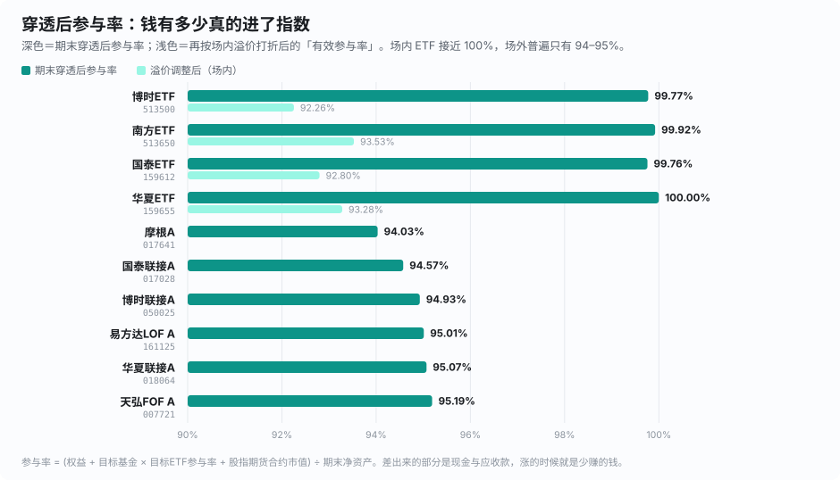
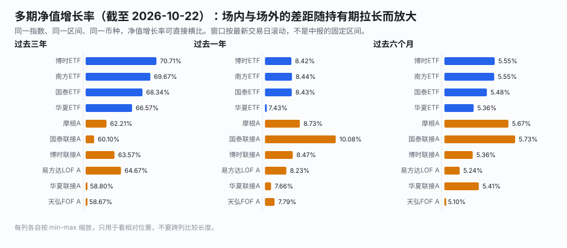
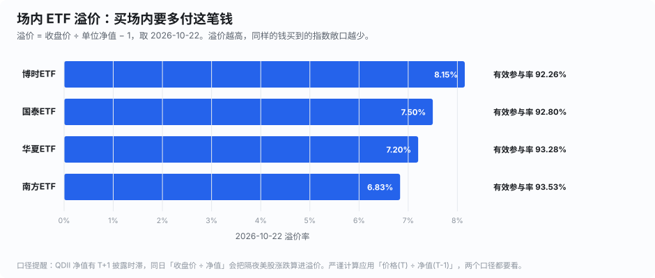
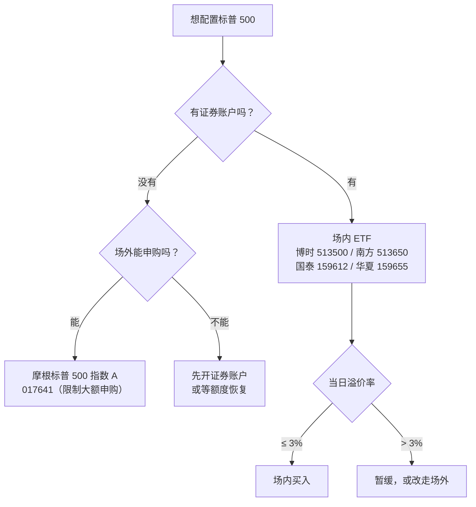
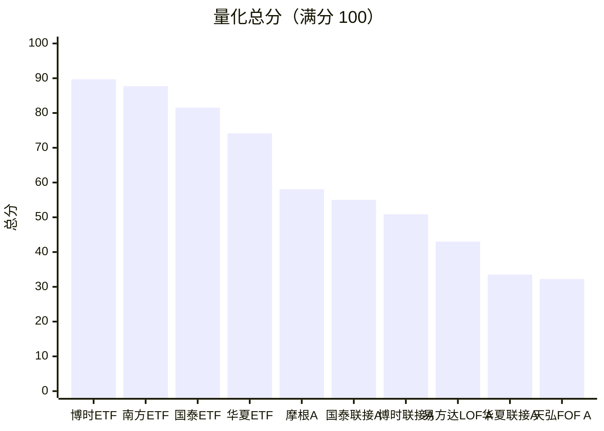

# sp500-cn-comparison

中国境内跟踪标普 500 的标的横向对比 —— 从 2026 年中期报告穿透到"真实参与率 / 加权综合费率 / 场内溢价"。

> 方法论来自 B 站 [@林怀瑾LHJ《同样跟踪纳斯达克 100，为什么国泰场外在前列？》](https://www.bilibili.com/video/BV1rdet6MEXA)（BV1rdet6MEXA）。
> 该视频用"参与率 + 穿透 + 加权费率"三件事拆解了纳指 100 场外基金的业绩差异，本项目把同一套方法映射到标普 500。

> ### 🔗 在线浏览：[**4184f4d3d49841bbbea5ce00b8ba3263.sg2.agentos-app.run**](https://4184f4d3d49841bbbea5ce00b8ba3263.sg2.agentos-app.run)

- **在线版**（推荐）：上面的分享链接，打开即用，无需下载。
- **本地版**：[`index.html`](index.html) 单文件、无外部依赖、可离线打开。
- **GitHub Pages**（可选）：仓库 **Settings → Pages → Source: Deploy from a branch → main / (root)**，之后访问 `https://sayangchun.github.io/sp500-cn-comparison/`。
- **不想点开也行**：下面就是 Markdown 版主表，GitHub 上可直接读。

## 🔄 更新记录

**2026-10-25 更新（数据基准日 2026-10-22）**

三季报要到 10-31 前才披露，所以**参与率 / 费率 / 规模仍是 2026 中报口径**；多期收益、场内溢价、申购状态已滚动到最新交易日。三件事变了：

1. **场内溢价大幅扩大**：四只 QDII ETF 从一年前的 1.90%–5.27% 涨到 **6.83%–8.15%**，溢价调整后的有效参与率从 96%+ 降到 **92.3%–93.5%**。同期 **国泰 ETF（159612）暂停申购**，新份额停止创设——这正是它溢价走高的直接原因。
2. **座次换了**：博时 ETF 反超登顶（89.70），华夏 ETF 从第 1 掉到第 4（91.04 → 74.14），原因是它近一年 7.43% 在四只 ETF 里垫底（其余 8.42%–8.44%）。
3. **国泰联接从第 10 跳到第 6**，但它的名次在 **1–8 名之间跳**（见窗口稳健性），靠的是近一年 10.08% 这一个窗口，近三年 60.10% 只排第 6。**不建议据此重仓。**

| 产品 | 上次 | 本次 | 名次 | 上次得分 | 本次得分 |
|---|---:|---:|---:|---:|---:|
| 博时ETF `513500` | 2 | **1** | ↑1 | 90.08 | **89.70** |
| 南方ETF `513650` | 3 | **2** | ↑1 | 87.45 | **87.73** |
| 国泰ETF `159612` | 4 | **3** | ↑1 | 83.98 | **81.54** |
| 华夏ETF `159655` | 1 | **4** | ↓3 | 91.04 | **74.14** |
| 摩根A `017641` | 5 | **5** | — | 57.95 | **58.09** |
| 国泰联接A `017028` | 10 | **6** | ↑4 | 32.17 | **55.00** |
| 博时联接A `050025` | 6 | **7** | ↓1 | 54.14 | **50.86** |
| 易方达LOF A `161125` | 8 | **8** | — | 45.31 | **43.00** |
| 华夏联接A `018064` | 7 | **9** | ↓2 | 50.24 | **33.54** |
| 天弘FOF A `007721` | 9 | **10** | ↓1 | 32.24 | **32.24** |

> 上次口径：数据截至 2026-06-30，收益用中报的固定窗口。本次口径：收益滚动至 2026-10-22。

## 一张图看懂



**怎么读这张图**：每行是一只产品，条形按五个维度堆叠，右侧数字是加权总分。
排名徽标里绿色是前四名（全是场内 ETF），红色是后三名。

三个一眼可见的事实：

1. **前四名与场外仍有断层**（74.1 → 58.1），但比上次窄了（上次是 84.0 → 58.0）。
   场外的近一年收益追上来一些，而场内的溢价成本上去了。
2. **场内 ETF 的敞口几乎是满分**（19.2–20.0/20），场外普遍只有 0–3.9 分——
   因为它们有 5% 上下的净值停在现金和应收款里，牛市里这就是少赚的钱。
3. **摩根 A 和易方达 LOF 各有一项满分、也各有一项垫底**：
   摩根费率最低（20/20）但敞口最差（0/20）；易方达规模最稳（11.6/12）但费率最高（0/20）。

## 四张图看清差异

### 1. 低费率 ≠ 好结果



左边按综合费率从低到高排，右边按三年收益从高到低排。**Spearman 秩相关只有 0.30**——
费率和收益几乎是两件独立的事。博时 ETF 费率只排第 6，三年收益排第 1；
摩根 A 费率最低，收益只排第 7。

### 2. 参与率：钱有多少真的进了指数



深色是期末穿透后参与率，浅色是再按场内溢价打折后的「有效参与率」。
场内 ETF 的穿透后参与率都在 99.8%–100%，但**打完溢价只剩 92.3%–93.5%**；
场外只有 94.0%–95.2%，但没有溢价这一层损耗。

### 3. 多期收益：差距随持有期拉长而放大



同一指数、同一区间、同一币种，净值增长率可以直接横比。
**近半年只差 0.63 个百分点（5.10%–5.73%），近三年差到 12.0 个百分点（58.67%–70.71%）**——
差距会随持有期复利放大，这也是打分里三年占 50% 权重的原因。

### 4. 场内溢价：一年内扩大了 2.2–5.3 个百分点



四只 ETF 在 2026-10-22 全部处于高溢价（6.83%–8.15%），比一年前的 1.90%–5.27% 明显走高。
按场内价买入，真正买到指数敞口的钱只有 92.3%–93.5%。
**国泰 ETF 已暂停申购**，份额停止创设，溢价短期难回落。

## 选基决策流程



> 场外 6 只产品里有 5 只目前是「暂停申购」，只有摩根 A 可以买（限制大额）。
> 场内四只里 **国泰 ETF 也已暂停申购**，只剩博时 / 南方 / 华夏可正常申购。
> 这一步不进评分，但会直接决定你实际能买到什么。

## 总分排名（原生图表版）



> 上面的 SVG 图信息更全（含五维拆解）；这一张是 GitHub 原生 Mermaid 渲染，在部分客户端里比 SVG 更稳。

## 推荐排名（多维度量化打分）

五个维度加权，满分 100。**限购额度未计入评分**；申购状态仅作标注。
权重：长期收益兑现 40 / 真实敞口 20 / 持有成本 20 / 规模与稳定 12 / 买入摩擦 8。
收益窗口：近三年 50% + 近一年 30% + 近半年 20%（各自年化后加权，滚动至 2026-10-22）。

| # | 产品 | 类型 | **总分** | 收益兑现<br>/40 | 真实敞口<br>/20 | 持有成本<br>/20 | 规模稳定<br>/12 | 买入摩擦<br>/8 | 近三年 | 近一年 | 近半年 | 综合费率 | 穿透后参与率 | 排名区间 | 申购状态<br>(仅标注) |
|---|---|---|---:|---:|---:|---:|---:|---:|---:|---:|---:|---:|---:|:---:|:---|
| 1 | 博时ETF<br>`513500` | 场内ETF | **89.70** | 40.0 | 19.2 | 11.4 | 11.6 | 7.4 | 70.71% | 8.42% | 5.55% | 0.80% | 99.77% | 1–2 | 场内买入 |
| 2 | 南方ETF<br>`513650` | 场内ETF | **87.73** | 37.4 | 19.7 | 14.3 | 8.8 | 7.5 | 69.67% | 8.44% | 5.55% | 0.75% | 99.92% | 1–2 | 场内买入 |
| 3 | 国泰ETF<br>`159612` | 场内ETF | **81.54** | 33.3 | 19.2 | 14.3 | 7.3 | 7.4 | 68.34% | 8.43% | 5.48% | 0.75% | 99.76% | 3–3 | 暂停申购 |
| 4 | 华夏ETF<br>`159655` | 场内ETF | **74.14** | 21.0 | 20.0 | 14.3 | 11.4 | 7.5 | 66.57% | 7.43% | 5.36% | 0.75% | 100.00% | 4–4 | 场内买入 |
| 5 | 摩根A<br>`017641` | QDII直投 | **58.09** | 21.0 | 0.0 | 20.0 | 9.1 | 8.0 | 62.21% | 8.73% | 5.67% | 0.65% | 94.03% | 5–6 | 限制大额申购 |
| 6 | 国泰联接A<br>`017028` | 联接 | **55.00** | 24.8 | 1.8 | 12.1 | 8.3 | 8.0 | 60.10% | 10.08% | 5.73% | 0.79% | 94.57% | 5–6 | 暂停申购 |
| 7 | 博时联接A<br>`050025` | 联接 | **50.86** | 19.9 | 3.0 | 8.1 | 11.8 | 8.0 | 63.57% | 8.47% | 5.36% | 0.86% | 94.93% | 7–7 | 暂停申购 |
| 8 | 易方达LOF A<br>`161125` | QDII-LOF | **43.00** | 20.2 | 3.3 | 0.0 | 11.6 | 8.0 | 64.67% | 8.23% | 5.24% | 1.00% | 95.01% | 8–10 ⚠ | 暂停申购 |
| 9 | 华夏联接A<br>`018064` | 联接 | **33.54** | 2.3 | 3.5 | 10.5 | 9.2 | 8.0 | 58.80% | 7.66% | 5.41% | 0.82% | 95.07% | 8–9 | 暂停申购 |
| 10 | 天弘FOF A<br>`007721` | QDII-FOF | **32.24** | 0.0 | 3.9 | 9.0 | 11.3 | 8.0 | 58.67% | 7.79% | 5.10% | 0.84% | 95.19% | 9–10 | 暂停申购 |

**分数是组内相对分**（该维度最好的得满分、最差的得 0 分），0 分只代表「在这 10 只里最差」，不代表绝对差。

### 稳健性检验 ①：换权重会不会翻盘

| 产品 | 基准权重 | 收益优先 | 成本优先 | 结构优先 | 排名区间 | 结论 |
|---|---:|---:|---:|---:|:---:|---|
| 博时ETF | 1 | 1 | 2 | 1 | 1–2 | 权重不敏感 |
| 南方ETF | 2 | 2 | 1 | 2 | 1–2 | 权重不敏感 |
| 国泰ETF | 3 | 3 | 3 | 3 | 3–3 | 权重不敏感 |
| 华夏ETF | 4 | 4 | 4 | 4 | 4–4 | 权重不敏感 |
| 摩根A | 5 | 6 | 5 | 5 | 5–6 | 权重不敏感 |
| 国泰联接A | 6 | 5 | 6 | 6 | 5–6 | 权重不敏感 |
| 博时联接A | 7 | 7 | 7 | 7 | 7–7 | 权重不敏感 |
| 易方达LOF A | 8 | 8 | 10 | 8 | 8–10 | 对权重敏感 ⚠ |
| 华夏联接A | 9 | 9 | 8 | 9 | 8–9 | 权重不敏感 |
| 天弘FOF A | 10 | 10 | 9 | 10 | 9–10 | 权重不敏感 |

三组替代权重：收益优先 = 55/15/15/10/5；成本优先 = 25/15/40/12/8；结构优先 = 30/35/20/10/5。

### 稳健性检验 ②：换收益窗口会不会翻盘

把收益维度分别换成「只看三年 / 只看一年 / 只看半年」，其余维度不变重算。**跨度越小，名次越可信。**

| 产品 | 基准 | 只看三年 | 只看一年 | 只看半年 | 名次跨度 | 结论 |
|---|---:|---:|---:|---:|---:|:---|
| 博时ETF | 1 | 1 | 3 | 2 | **2** | 略有浮动 |
| 南方ETF | 2 | 2 | 2 | 1 | **1** | 窗口不敏感 |
| 国泰ETF | 3 | 3 | 4 | 4 | **1** | 窗口不敏感 |
| 华夏ETF | 4 | 4 | 6 | 6 | **2** | 略有浮动 |
| 摩根A | 5 | 5 | 5 | 3 | **2** | 略有浮动 |
| 国泰联接A | 6 | 8 | 1 | 5 | **7** | **对窗口高度敏感** ⚠ |
| 博时联接A | 7 | 6 | 7 | 8 | **2** | 略有浮动 |
| 易方达LOF A | 8 | 7 | 9 | 10 | **3** | 略有浮动 |
| 华夏联接A | 9 | 10 | 10 | 7 | **3** | 略有浮动 |
| 天弘FOF A | 10 | 9 | 8 | 9 | **2** | 略有浮动 |

**南方 ETF 在四种窗口下都在 1–2 名，是最稳的。国泰联接在 1–8 名之间跳**——
它的近一年 10.08% 全场最高，但近三年 60.10% 只排第 6，说明那个「第一」是最近一年才出现的，不可外推。

### 打分口径说明

- **收益维度只用净值增长率，不用「①−③」超额收益。** 这些产品跟踪同一指数、同一区间、同一币种，净值增长率本身完全可比；而各家业绩比较基准口径不统一（半年基准收益从 5.86% 到 6.60%），用超额收益会把口径差异算成基金能力。
- **收益用累计净值计算**（正确处理分红），**溢价用单位净值计算**。
- **持有成本用加权综合费率**（目标 ETF 费率 + 本层费率 × 非 ETF 权重），不是页面上写的本层费率。
- **买入摩擦用最新溢价**：场内 `1 ÷ (1 + 溢价率)`，场外无溢价 = 满分。溢价是动态的，实际下单前要看当日实时溢价率。
- 评分基于 A 类份额（长期持有费率更优）。持有期 1–2 年内 C 类通常更划算，排名需要重算。

### 怎么用这个排名

1. **前四名全是场内 ETF，但内部差异很大**（74.1–89.7）。博时规模最大（240 亿）、三年收益最好；南方最稳（四种窗口都在 1–2 名）；华夏近一年掉队；国泰规模仅 8.4 亿且已暂停申购。
2. **溢价是当下最该看的一列**。四只 ETF 溢价 6.8%–8.2%，意味着你多付了这么多钱买同一份指数敞口。**溢价 > 5% 时，场内买入的性价比已经明显不如等额度恢复后走场外。**
3. **摩根 A 是场外唯一能买的**：费率全场最低（0.65%），但参与率全场最低（94.03%，且完全没用股指期货补敞口），三年收益也靠后。能买，但别指望它跑赢场内。
4. **不要用单一年度排名做决定**。国泰联接的 1 年 vs 3 年名次差了 7 位，就是最好的反例。

## 主表：参与率、费率与中报收益（结构数据截至 2026-06-30）

结构指标（参与率、费率、规模）来自 2026 中报，这是 Q3 季报披露前的最新可得数据；收益列保留中报的固定窗口，与最新滚动的差异见「更新记录」。

| 产品 | 类型 | 权益 | 目标基金 | 期货(名义) | 直接参与率 | 穿透后参与率 | vs 基准权重 | 本层管托 | 加权综合费率 | 净值6m(中报) | 基准6m | ①−③ |
|---|---|---:|---:|---:|---:|---:|---:|---:|---:|---:|---:|---:|
| 华夏ETF<br>`159655` | 场内ETF | 97.66% | — | 2.34% | 100.00% | **100.00%** | -0.00 | 0.75% | **0.75%** | 6.51% | 6.29% | +0.22 |
| 南方ETF<br>`513650` | 场内ETF | 98.32% | — | 1.60% | 99.92% | **99.92%** | -0.08 | 0.75% | **0.75%** | 6.21% | 6.16% | +0.05 |
| 博时ETF<br>`513500` | 场内ETF | 95.83% | — | 3.94% | 99.77% | **99.77%** | -0.23 | 0.80% | **0.80%** | 6.22% | 6.60% | -0.38 |
| 国泰ETF<br>`159612` | 场内ETF | 90.31% | — | 9.45% | 99.76% | **99.76%** | -0.24 | 0.75% | **0.75%** | 6.27% | 6.16% | +0.11 |
| 天弘FOF A<br>`007721` | QDII-FOF | — | 91.02% | 4.17% | 95.19% | **95.19%** | +0.19 | 0.80% | **0.84%** | 5.55% | 5.87% | -0.32 |
| 华夏联接A<br>`018064` | 联接 | 0.00% | 91.21% | 3.86% | 95.07% | **95.07%** | +0.07 | 0.75% | **0.82%** | 6.81% | 6.00% | +0.81 |
| 易方达LOF A<br>`161125` | QDII-LOF | 90.69% | — | 4.32% | 95.01% | **95.01%** | +0.01 | 1.00% | **1.00%** | 6.13% | 5.87% | +0.26 |
| 博时联接A<br>`050025` | 联接 | — | 92.73% | 2.40% | 95.14% | **94.93%** | -0.07 | 0.80% | **0.86%** | 6.12% | 6.29% | -0.17 |
| 国泰联接A<br>`017028` | 联接 | — | 94.80% | — | 94.80% | **94.57%** | -0.43 | 0.75% | **0.79%** | 6.90% | 5.87% | +1.03 |
| 摩根A<br>`017641` | QDII直投 | 94.03% | — | — | 94.03% | **94.03%** | -0.97 | 0.65% | **0.65%** | 6.60% | 5.86% | +0.74 |

> **穿透后参与率** ＝ 联接层持有的目标 ETF 占净值比 × 目标 ETF 自身的参与率 + 本层期货名义敞口。
> **加权综合费率** ＝ 目标 ETF 费率 + 本层费率 ×(1 − 目标 ETF 权重)。联接对目标 ETF 部分免收管托；QDII-FOF 持别人家 ETF，无法豁免。

### 场内溢价与有效参与率（截至 2026-10-22）

| ETF | 2025-10-22 溢价 | 2026-10-22 溢价 | 变化 | 溢价调整后参与率 | 申购状态 |
|---|---:|---:|---:|---:|:---|
| 博时ETF<br>`513500` | +4.52% | **+8.15%** | +3.63 pp | **92.26%** | 场内买入 |
| 国泰ETF<br>`159612` | +5.27% | **+7.50%** | +2.23 pp | **92.80%** | 暂停申购 |
| 华夏ETF<br>`159655` | +1.90% | **+7.20%** | +5.30 pp | **93.28%** | 场内买入 |
| 南方ETF<br>`513650` | +1.94% | **+6.83%** | +4.89 pp | **93.53%** | 场内买入 |

> **溢价调整后参与率** ＝ 穿透后参与率 ÷ (1 + 溢价率)。按场内价买入，真正买到指数敞口的钱只有 92.3%–93.5%。
> 口径提醒：QDII 净值有 T+1 披露时滞，同日「收盘价 ÷ 净值」会把隔夜美股涨跌算进溢价，严谨计算应用 `价格(T) ÷ 净值(T-1)`。

---

## 覆盖标的（10 只）

| 类型 | 产品 |
|---|---|
| 场内 ETF | 513500 博时、159612 国泰、159655 华夏、513650 南方 |
| 场外 ETF 联接 | 050025 博时联接 A、017028 国泰联接 A、018064 华夏联接 A |
| 场外 QDII-FOF | 007721 天弘标普 500 发起 A |
| 场外 QDII-LOF / 直投 | 161125 易方达标普 500 指数 A、017641 摩根标普 500 指数 A |

**收录口径**：仅市值加权的纯标普 500 指数产品。标普 500 等权重、标普 100 等权重、以及标普行业/主题指数（红利低波、油气、消费、生物科技、信息科技等）均不收录。

---

## 指标定义

| 指标 | 定义 |
|---|---|
| 直接参与率 | (权益投资 + 基金投资 + 股指期货**合约市值**) ÷ 期末净资产 |
| 穿透后参与率 | 联接层持有目标 ETF 的部分，再乘目标 ETF 自身的参与率；期货按合约市值计 |
| 加权综合费率 | 目标 ETF 费率 + 本层费率 ×(1 − 目标 ETF 权重) |
| 基准隐含指数收益 | (基准收益率 − 现金权重 × 活期利率) ÷ 指数权重 |
| 理论收益 / 跟踪缺口 | 穿透后参与率 × 基准隐含指数收益 − 实际净值增长率 |
| 反推平均参与率 | 半年净值增长率 ÷ 基准隐含指数收益（含全部成本，正常应低于期末参与率） |
| 联接层相对目标 ETF | (1 + 联接收益) ÷ (1 + 目标 ETF 收益) − 1 |
| 溢价调整后参与率 | 穿透后参与率 ÷ (1 + 期末溢价率) |

三个容易踩的坑（与视频一致）：

1. **期货公允价值为 0 ≠ 没参与。** 当日无负债结算下期货公允价值与暂收款抵销为 0，名义敞口必须看「合约市值」。
2. **账面现金 ≠ 没参与。** QDII 基金常留 5%–10% 活期，同时用期货把敞口补满。
3. **联接基金对目标 ETF 部分免收管理费/托管费**，而 QDII-FOF 持有的是别人家的 ETF，无法豁免 —— 这是双重收费的隐蔽来源。

---

## 目录结构

```
index.html                 交互报告（由 scripts/build_site.py 生成）
assets/                    README 内嵌图表（由 scripts/build_charts.py 生成的 SVG）
data/
  reports_index.json       定期报告清单（标题 / 公告 ID / 日期）
  raw_reports.json         中报解析结果（资产组合、期货、费率条款、净值增长率…）
  analysis.json            穿透计算后的指标（中报口径）
  latest.json              最新快照（净值/溢价/申购状态，滚动至最新交易日）
  rolling_perf.json        滚动多期收益
  score.json / score_prev.json  本次 / 上次打分结果（用于对比）
  window_robust.json       收益窗口稳健性检验
  quotes_cache.json        场内日收盘价
  nav_per_share.json       关键日期份额净值
  pdf/                     中报 PDF（.gitignore，可由脚本重新下载）
  txt/                     PDF 抽取文本（.gitignore）
scripts/
  fetch_reports.py         1. 下载定期报告
  parse_reports.py         2. 解析中报 PDF → JSON
  fetch_quotes.py          3. 抓行情与份额净值
  analyze.py               4. 穿透计算
  fetch_nav_history.py     5. 抓全量净值历史 + 滚动多期收益
  refresh_latest.py        6. 最新快照（净值/场内价/溢价/申购状态）
  score.py                 7. 多维度量化打分排名
  build_charts.py          8. 生成 assets/*.svg（README 内嵌图表）
  build_readme.py          9. 重建 README 里所有随数据变动的章节
  build_site.py           10. 生成 index.html
  push_via_api.py          备用推送（git push 被代理阻断时走 GitHub API）
```

---

## 复现

```bash
python -m venv .venv && . .venv/bin/activate    # Windows: .venv\Scripts\activate
pip install -r requirements.txt

python scripts/fetch_reports.py     # -> data/reports_index.json, data/pdf/*.pdf
python scripts/parse_reports.py     # -> data/raw_reports.json
python scripts/fetch_quotes.py      # -> data/quotes_cache.json, data/nav_per_share.json
python scripts/analyze.py           # -> data/analysis.json
python scripts/fetch_nav_history.py # -> data/nav_history.json, rolling_perf.json
python scripts/refresh_latest.py    # -> data/latest.json（最新快照）
python scripts/score.py             # -> data/score.json（多维度量化打分排名）
python scripts/build_charts.py      # -> assets/*.svg（README 内嵌图表）
python scripts/build_readme.py      # -> 重建 README 的数据章节
python scripts/build_site.py        # -> index.html
```

> 图表用纯 SVG 手写生成（不依赖 matplotlib / 中文字体），因此体积只有几十 KB、
> 在任何缩放下都清晰，也能被 GitHub 直接内嵌渲染。README 里的 Mermaid 图由 GitHub 原生渲染。
>
> `scripts/push_via_api.py` 是一个备用推送工具：当 `git push` 被网络代理阻断时，
> 用 GitHub REST API（Git Data API）把本地快照提交到远端，用法
> `python scripts/push_via_api.py "提交信息"`。正常网络环境下不需要它。

数据源全部为公开接口，无需登录：

| 用途 | 接口 |
|---|---|
| 公告列表 | `api.fund.eastmoney.com/f10/JJGG` |
| 定期报告 PDF | `pdf.dfcfw.com/pdf/H2_{ID}_1.pdf` |
| 份额净值 | `api.fund.eastmoney.com/f10/lsjz` |
| 场内日 K | `web.ifzq.gtimg.cn/appstock/app/fqkline/get` |

**已做的交叉验证**：

- 中报 3.2.1 的「过去六个月份额净值增长率」与独立拉取的日净值复算结果逐只核对一致（含分红调整）。
- 场内收盘价同时用东方财富 `push2his` 与腾讯行情逐点核对一致。
- 期末净资产均满足 `0 < 净资产 ≤ 总资产`，且与净资产变动表勾稽一致。

---

## 局限（重要）

1. **业绩比较基准口径不统一。** 同样标普 500，博时 ETF 明确写 NTR（净总收益）得 6.60%，国泰/南方 ETF 只有 6.16%。含息/价格指数、估值汇率/人民币汇率、指数起止时点都可能贡献差异，中报只给结论不给计算明细。因此报告中所有"理论收益/缺口"均用两个统一口径（6.60% / 6.16%）分别计算，请当区间看。
2. **参与率只有期末一个时点。** 中报只披露 6 月 30 日持仓，规模半年快速膨胀的产品，期内平均参与率可能显著低于期末值。
3. **联接基金跑赢自家目标 ETF 的现象未能解释。** 国泰联接 A（6.90%）高于其持有的国泰标普 500 ETF（6.27%）。候选解释是联接按目标 ETF 收盘价而非净值估值，而 QDII ETF 长期溢价、溢价路径变化会进出联接净值 —— 但中报不披露估值方法，无法确证。
4. **场内溢价率的口径陷阱。** QDII 基金净值存在 T+1 披露时滞，同日「收盘价 ÷ 净值」会把隔夜美股涨跌算进溢价。严谨计算应使用 `价格(T) ÷ 净值(T-1)`。
5. **等权重与主题指数已剔除。** 标普 500 等权重（096001 大成）、标普 100 等权重（519981 长信）跟踪的指数与市值加权标普 500 不同，可比性差，已从基金池中移除，避免与主表混排。

---

## 免责声明

本项目仅作公开数据的整理与结构化对比，**不构成任何投资建议**。所有推算指标均基于基金定期报告，受口径差异影响，请当作区间参考。

## License

MIT
